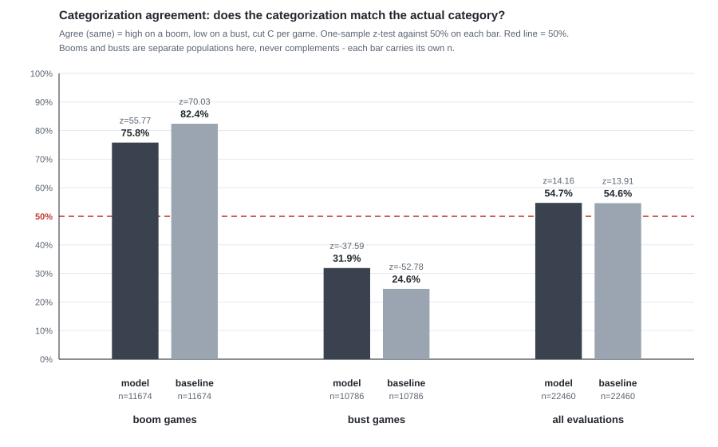
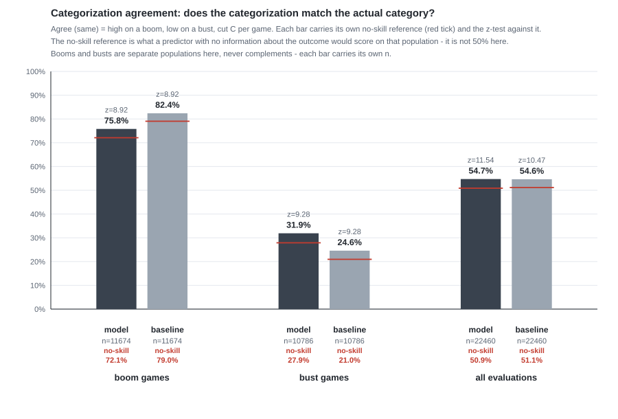
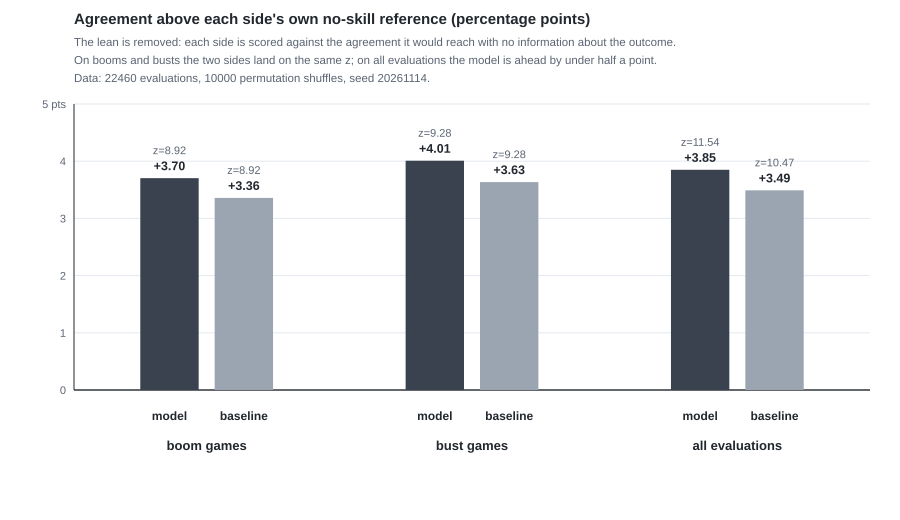

# QA — the reference line for agreement rates (2026-11-14)

Built by mavis. Triggered by the owner's question: **"against 50%? what does that even mean?"**

## 1. Symptom

`docs/mavis-projection-evaluation.md` tested every agreement rate with a one-sample z-test against a flat **50%**, and described that line as "the spec's fixed reference". The headline table led with those z-scores (model booms z = 55.77, baseline booms z = 70.03) and the verdict read "the baseline wins boom agreement, the model wins bust agreement".

Two things were wrong with it, and the second one changed a conclusion.

## 2. Cause

- **The reference was not the no-skill line.** 50% is the coin-flip reference, and it is only right when the actual outcome is a 50/50 split *and* the predictor is a 50/50 coin flip. Neither holds here: booms are **52.0%** of evaluations (the cut C is the median split of the player's own earlier games), and both predictors lean high — the model says high on **72.1%** of evaluations, the baseline on **79.0%**. A predictor that knows nothing at all therefore already agrees ~51% of the time. Measuring against 50% overstates every edge, and it overstates the *harder-leaning baseline* the most.
- **The 50% was attributed to the owner's spec, which sets no such line.** The only 50% in `docs/DFS Projection Model.md` is the even-split floor — "half high half low = total projection", P = 0.5 when no factor clears the evidence floor. That is a floor on a *projection*. It was never a reference for an *agreement rate*. The document asserted it was; it was not.
- **The raw agreement gaps were read as skill when they were mostly lean.** The baseline's 82.4% boom agreement looks like a win over the model's 75.8%; in fact the baseline leans high 6.9 points harder, and once each side is scored against its own reference the two are level (both z = 8.92).

## 3. Change

New script `frontend/react/scripts/mavis-evaluation-significance.mjs` reads the harness CSV and computes the no-skill reference, the z-test against it, permutation tests (10,000 shuffles, seed 20261114), the 2×2 chi-square with φ, and the paired model-vs-baseline test. It writes `.tmp-audit/projection-significance.json`. The document, the charts and the harness script were updated to use it.

| # | what | before | after |
|---|---|---|---|
| 1 | reference line | flat 50% | each side's own no-skill reference: model 72.1 / 27.9 / 50.9%, baseline 79.0 / 21.0 / 51.1% (boom / bust / overall) |
| 2 | z, model booms | z = 55.77 vs 50% | z = 8.92 vs its own reference (gap +3.70 pts) |
| 3 | z, model busts | z = −37.59 vs 50% | z = 9.28 vs its own reference (gap +4.01 pts) |
| 4 | z, model overall | z = 14.16 vs 50% | z = 11.54 vs its own reference (gap +3.85 pts) |
| 5 | z, baseline booms | z = 70.03 vs 50% | z = 8.92 vs its own reference (gap +3.36 pts) |
| 6 | z, baseline busts | z = −52.78 vs 50% | z = 9.28 vs its own reference (gap +3.63 pts) |
| 7 | z, baseline overall | z = 13.91 vs 50% | z = 10.47 vs its own reference (gap +3.49 pts) |
| 8 | confirmation | none | permutation test, 10,000 shuffles, seed 20261114: p = 0.0001 on every rate, both sides |
| 9 | effect size | none | χ²(1) = 165.77, φ = 0.0859 (model); χ²(1) = 165.52, φ = 0.0858 (baseline) |
| 10 | model vs baseline | raw rates read as a win | paired test on the same 22,460 games: model alone right on 1,602, baseline alone right on 1,583; McNemar χ²(1) = 0.11, p = 0.74 — a dead tie |
| 11 | verdict | "the baseline wins boom agreement, the model wins bust agreement" | "the model and the plain prior-games average are statistically indistinguishable; both carry a small real signal of ~+3.5 to +4 points; the factor machinery moves the shape of the agreement, not its size" |
| 12 | chart (c) | one red dashed 50% line across the plot | no 50% line; each bar carries its own red no-skill reference tick and the z against it |
| 13 | new chart | — | chart (f): agreement above each side's own reference, in points — the lean removed |
| 14 | harness script | "one-sample z-test against 50%" in the header, the JSON definitions and the console headline | relabelled everywhere as the coin-flip line, with a pointer to the significance script, so a rebuild cannot reintroduce the framing |
| 15 | document | "50% is the spec's fixed reference" | new sections "no-skill reference" and "the 50% line, and why it was the wrong reference"; a revision note at the top |

**Not changed:** the 24,981 games of record, the 22,460 evaluations, the cut C, the engine, the per-game CSV, every factor and every path code. Only the comparison line and the reading of it.

## 4. Before / after

**Before** — chart (c) with the single red 50% line (commit `a86bb11`, `git show a86bb11:docs/shots/mavis-eval-agreement.svg`):

**After** — chart (c), each bar against its own no-skill reference:

**After** — new chart (f), the lean removed:

## 5. Files

- `frontend/react/scripts/mavis-evaluation-significance.mjs` — new
- `frontend/react/.tmp-audit/projection-significance.json` — new output (git-ignored)
- `docs/mavis-projection-evaluation.md` — reference line, how-to-read, definitions, method, charts, caveats, verdict, file list
- `docs/shots/mavis-eval-agreement.svg` — rebuilt; `docs/shots/mavis-eval-agreement-before.svg` — the previous chart, kept for the record
- `docs/shots/mavis-eval-gap.svg` — new
- `frontend/react/scripts/mavis-evaluation-charts.mjs` — reads both JSONs, per-bar reference ticks, new chart
- `frontend/react/scripts/mavis-projection-evaluation.mjs` — relabelled

Rebuild: `node scripts/mavis-projection-evaluation.mjs` → `node scripts/mavis-evaluation-significance.mjs` → `node scripts/mavis-evaluation-charts.mjs`, from `frontend/react`.
