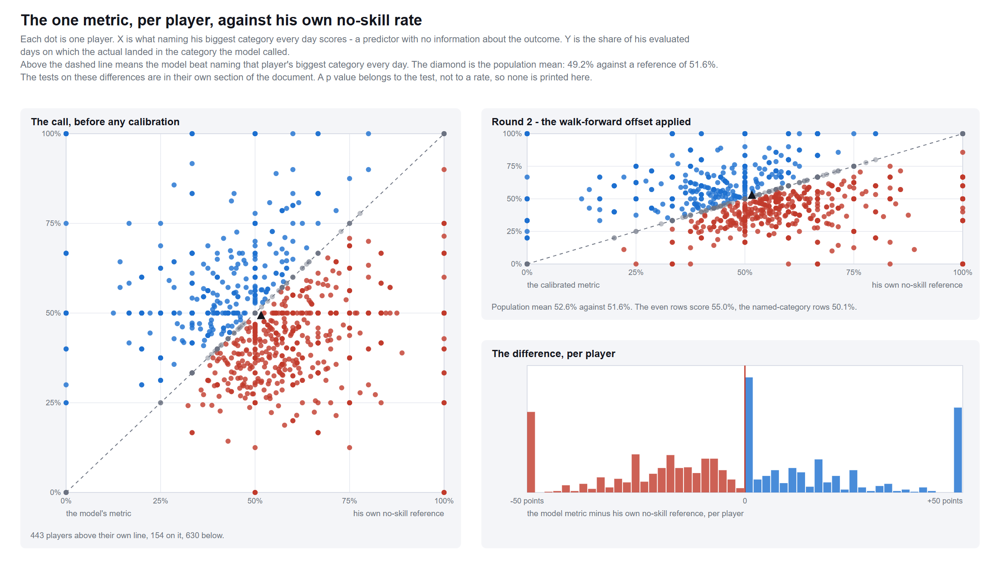
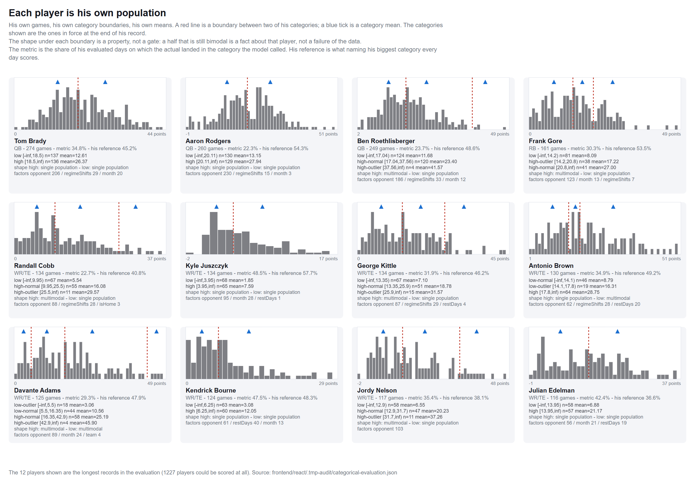

# The categorical evaluation: Dave's method, run as categories

Built by mavis. Date: 2026-11-26. The method is `docs/DFS Projection Model.md`, verbatim. The engine under test is `frontend/react/src/lib/dave-projection.ts`. The data is `frontend/react/.tmp-audit/projection-evaluation.csv` (25,162 rows, built by `frontend/react/scripts/mavis-projection-evaluation.mjs`). The analysis is `frontend/react/scripts/mavis-categorical-evaluation.mjs`; the charts are `frontend/react/scripts/mavis-categorical-charts.mjs`.

**This document supersedes `docs/mavis-player-scoped-evaluation.md`** (2026-11-23). That file stays in the repository as a dated record of the framing it measured; it is not the current evaluation, and none of its numbers should be quoted as current. Nothing below the pointer in that file has been rewritten.

## What changed on 2026-11-26, and why

Five corrections, all from the owner, all applied here:

1. **Sameness is the only thing that is accepted or rejected.** Are the two halves one population or two. That is the model's only test. Everything else - a factor, a category, a threshold, a mean - is a categorization, not a verdict. Nothing in this document accepts or rejects a factor, and no cluster is excluded for failing a normality check.
2. **A p-value is not a variable and it does not sit next to a hit rate.** Significance lives in its own section, at the end, and appears in no table, chart or caption that carries a rate.
3. **A coefficient is not a variable.** The engine used to carry a coefficient and the old write-up printed it as a label. That field is gone; the engine's output is a category.
4. **The formulas had to match the document, so the engine was rewritten.** Four formulas were wrong. They are fixed, and the change is in the engine, not in the write-up.
5. **The result is a truth, not a verdict.** So the results below are: the categories each player's games fall in, the boundary between them, the mean of each, the factor that threads them, and the one metric that scores the calls - each stated as what it is, with nothing attached to it that the data does not say.
### The four formulas that were wrong

| what | before | now | why |
|---|---|---|---|
| the projection target | the high or low half's raw mean | the mean of the category that was called | his document projects the cluster he has identified. A boom is an outlier beyond the upper limit; if the projection is the half mean, the boom is unreachable by construction |
| the call | a side, `high` or `low` | a category: `high`, `high-normal`, `high-outlier`, `low`, `low-normal`, `low-outlier`, or `even` | the categories are the model. A side cannot name a boom |
| outlier detection | peeling the extreme points off a half | the hump rule: 1-point bins, smoothed counts, a peak needs at least 2 games in its bin and at least 3 games of mass, a valley must fall to at most half the smaller neighbouring peak | his step 7: a threshold means a hump, not one or two spikes |
| the normality gate | clusters that failed normality were excluded | the shape under each boundary is recorded as a property, and nothing is excluded | a cluster that is still bimodal is a fact about that player, not a failure of the data |

The engine's public shape changed with it. In: `call`, `categories[]`, `separated[]`, `cut`, `factorCondition`, `sameMeansTest`, `shape`, and the two-sided Welch p-value on the sameness test. Out: `p`, `peeled`, `normality`, `factorDetail`. `frontend/react/scripts/dave-port.mjs` is compiled from the engine by `tsc`, not written by hand, and a parity test fails if the two drift.
## The method, as executed

| his step | what ran |
|---|---|
| 1. pick a player | 2,531 players of record, all read; every player is his own population, never pooled with anyone else's |
| 2. take all his games over your range | every game of record for that player, all seasons 2002-2026, for teams ne, gb, pit, sf |
| 3. histogram the key metric | 1-point bins over his own DraftKings fantasy points |
| 4. observe it and run descriptive statistics | mean, median, SD, IQR, skew and kurtosis per player per half; the shape verdict is recorded, never used as a gate |
| 5. skewness and one-off spikes are normal; multiple modes are the finding | hump detection with a published rule, above |
| 6. read the thresholds off the histogram | one threshold per valley between humps; the boundary is stored on the row, so any categorisation can be re-checked from the columns alone |
| 7. each threshold is a hump behaving normally in isolation | **not applied as a filter.** The shape under a threshold is reported as a property of that player - `multimodal` or `single population` - and a still-bimodal half stays in the analysis |
| 8. evaluate the thresholds for common cause | candidate causes: opponent, team, month, isHome, restDays, regimeShifts; each player-condition pair tested separately; every candidate is reported with its coverage and purity, and the one that threads the separated population becomes the factor |
| 9. derive the factor and test it | the factor's condition is the common thread of the separated population (coverage at least 0.5); the p-value of that comparison is the evidence, and it is reported in its own section |
| 10. test it against the recent game, run the calculation, project, then evaluate the next week | walk-forward: the categories, the means and the offset are re-derived from games already seen and applied to the next game; every game is categorised, never dropped |
| 11. repeat for players 2-7000 | 1,227 players could be scored. 1,304 could not - fewer than four completed games, so no two populations exist yet - and they are recorded as a fact, not dropped |
## The data

| | |
|---|---|
| teams | ne, gb, pit, sf |
| seasons | 2002 through 2026, completed regular seasons |
| events held | 1,541 of 1,541 planned |
| games of record | 25,162 rows, 2,531 players |
| scored rows | 17,641 |
| players that could be scored | 1,227 |
| players with no projection yet | 1,304 - fewer than four completed games, so no two populations exist yet |
| scoring | DraftKings published rubric, from ESPN event summaries |
| requests / failures | 2,073 / 0 |

**Actuals check.** Every row's DraftKings score was compared against the preserved pre-correction run: **25,104 rows compared, 0 differing**. 58 rows are new, because ESPN has published three more completed games and four more players since that run. No existing actual changed.

## The one metric

Dave's metric, per player: the proportion of that player's evaluated days on which the actual landed in the category the model called. A call of `even` scores one half, because the even split is a coin flip by definition.

## The no-skill reference

The reference is not 50%. It is the rate a predictor with no information about the outcome scores: always name that player's biggest category, on every day. It is computed from each row's own categories, so it differs player by player. Ties for the biggest category go to the higher-scoring category; the other tie-break is carried as a robustness line in the significance section, so the reference cannot be accused of a favourable tie-break.
## What the model calls

The call census over the 17,641 scored rows. These are the categories the model named, counted. They are not verdicts.

| call | rows | share |
|---|---|---|
| `high` | 5,152 | 29.2% |
| `even` | 5,028 | 28.5% |
| `low` | 3,305 | 18.7% |
| `high-outlier` | 3,295 | 18.7% |
| `low-outlier` | 809 | 4.6% |
| `low-normal` | 49 | 0.3% |
| `high-normal` | 3 | 0.0% |

And what the actuals were, counted the same way. A **boom** is an actual in the separated category on the high side that sits above the high side's main body; a **bust** is the mirror on the low side. A boom is a high game, but not every high game is a boom.

| outcome class | rows | share |
|---|---|---|
| high game | 8,028 | 45.5% |
| low game | 9,104 | 51.6% |
| boom | 322 | 1.8% |
| bust | 187 | 1.1% |
## The metric against the reference

One population per player. Every rate below is the average of per-player proportions - never a proportion over pooled games.

| | population mean | median | P25 | P75 |
|---|---|---|---|---|
| the model's metric | **49.2%** | 50.0% | 41.2% | 52.6% |
| the no-skill reference | **51.6%** | 50.0% | - | - |
| the difference | **-2.4 points** | -3.2 points | - | - |

Per player: **443 above their own reference, 154 on it, 630 below**.

The model, as built, does not beat naming the player's biggest category. That is the measurement, not a verdict on the method - the categories themselves are what the model has learned, and they are set out below.



The chart carries no p-value. A p-value belongs to a test, not to a rate, so the tests are in their own section further down.

## Each player is his own population



The twelve longest records. His own games, his own category boundaries (red), his own category means (blue), his shape verdicts, his factors, and his metric against his own reference. The shape under a boundary is a property, not a gate: a half that is still bimodal is a fact about that player.
## Round 2: the calibration loop

His model is a moving average whose window is meaningful events, not arbitrary dates. The calibration is the offset: the mean of actual minus projection over the games already seen, walk-forward, with no lookahead, applied to the next game's projection. The calibrated projection falls in a category and the same metric is measured again.

| | population mean |
|---|---|
| round 1, the call as it stands | 49.2% |
| round 2, the calibrated call | **52.6%** |
| - on the rows the model called `even` | 55.0% |
| - on the rows the model named a category | 50.1% |
| the no-skill reference | 51.6% |

The gain is attributable: it comes from the even rows. On the rows where the model named a category, the calibrated metric is 50.1% against a reference of 50.8% measured on those same rows.

## Precision

The metric is not closeness, and closeness is not what is being optimised here. Precision is the spread of the residual around the projection.

| | raw | calibrated |
|---|---|---|
| residual IQR (points) | 6.90 | 7.94 |
| share within +/- 2 points | 27.4% | 26.6% |
| mean absolute error (points) | 5.97 | 6.43 |

The mean offset applied by the calibration is **-1.25 points** - the model runs 1.25 points high on average before it is corrected. The calibration buys categorical agreement and costs residual spread. Both are facts about this run.
## The factors

A factor is a categorization. The engine looks for the condition that threads the separated population - the condition that holds for at least half of that population and covers it better than the alternatives - and reports every candidate it considered with its coverage and its purity. Nothing is accepted or rejected.

Which factor threads the separated population, across the 17,641 scored rows:

| factor | rows |
|---|---|
| opponent | 6,568 |
| month | 2,793 |
| regimeShifts | 1,036 |
| restDays | 976 |
| isHome | 641 |
| team | 600 |

The evidence attached to those comparisons:

| | rows | p below 0.05 | expected if uniform | median p | P25 | P75 |
|---|---|---|---|---|---|---|
| a population was separated | 4,415 | 2,885 (65.3%) | 220.75 | 0.0102 | 0.0001 | 0.1223 |
| nothing was separated | 8,199 | 5,765 (70.3%) | 409.95 | 0.0199 | 0.0029 | 0.0602 |

Read that carefully, because it is easy to over-read. The engine chooses the candidate that covers the separated population, so these p-values are selection-biased: the census reports which factor threads which population, and the p-value distribution is the evidence for that selection. It is **not** a test that a factor is valid, and the two rows above are not a finding that the factors work. The one-sided binomial tail for the excess over the uniform null is smaller than 10^-2550 in the first row and 10^-5392 in the second, which says only that selecting the best-covering candidate concentrates small p-values, as it must.
### The factor conditions, player by player

Every player's discovered conditions are recorded in `frontend/react/.tmp-audit/categorical-evaluation.json` under `players[].factorConditions`, with his categories, his means, his separated population and his shape verdicts beside them. Brett Favre is the worked example:

| | |
|---|---|
| games of record | 106, of which 102 scored |
| categories | `low` n=53, mean 9.23, up to 14.89 - `high-normal` n=40, mean 19.98, 14.89 to 26.58 - `high-outlier` n=12, mean 29.66, above 26.58 |
| separated population | `high-outlier`, 12 games, mean 29.66 |
| shape | high half `multimodal`, low half `single population` |
| factor | opponent (70 rows), restDays (19 rows), regimeShifts (3 rows), isHome (2 rows) |
| his metric against his own reference | 49.0% against 46.1% |

His discovered conditions, in the engine's own words: `opponent!=PHI`, `opponent!=TB`, `opponent!=SF`, `opponent!=NYJ`, `opponent=DET`, a ladder of 19 `restDays <` thresholds from `restDays < 22.40` down to `restDays < 17.77`, `regimeShifts < 0.28`, `regimeShifts < 0.30`, `regimeShifts < 0.35`, and `isHome=false`.

## Sameness: the only accept/reject

The model's one test: are the two halves one population or two. Welch's t on the two half means; a separation of less than 2.1 means the halves are the same and the projection falls back on their raw average.

| | rows |
|---|---|
| one population - the halves are the same | 1,567 |
| two populations - the halves differ | 16,074 |

Those are the only two outcomes the model accepts or rejects. Everything else in this document - the categories, the thresholds, the means, the factors - is a fact about a player.
## Significance

Its own section, on its own, with no rate anywhere near it. The question: across the 1,227 players, is the difference between the model's metric and that player's own no-skill reference different from zero?

| test | what it used | result |
|---|---|---|
| sign test | 443 above, 630 below, 154 on | **p = 1.25e-8** |
| Wilcoxon signed-rank | n = 1,073 non-zero differences, z = 4.34 | **p = 1.41e-5** (normal approximation with tie correction) |

The tie-break robustness line, with the reference computed the other way: the sign test gives p = 3.76e-26 (363 above, 707 below, 157 on), and the Wilcoxon z is 9.58, whose two-sided p-value is below the representable range - it is reported as log10(p) = -20.99 rather than as 0.
Two robustness lines. Neither is a filter: the whole population stays the headline.

| line | players | model | reference | difference |
|---|---|---|---|---|
| the whole population | 1,227 | 49.2% | 51.6% | -2.4 points |
| the whole population, calibrated | 1,227 | 52.6% | 51.6% | +1.0 points |
| players with 30 or more evaluated days | 159 | 40.3% | 50.8% | -10.6 points |
| - the same 159, calibrated | 159 | 43.8% | 50.8% | still below |
| rows where the model named a category | 901 | 45.7% | 50.8% | -5.2 points |

On the 901-player line: sign test p = 3.19e-7 (269 above, 402 below, 230 on), Wilcoxon p = 2.87e-5 (n = 671). On the 159-player line the split is 31 above, 2 on, 126 below.

The sameness test's own evidence, kept here with the rest of the significance material: over the 17,641 scored rows its p-values run at a median of 0.0009, with P25 at 0, P75 at 0.0385, and 77.5% of the rows below 0.05.
## What the data does not carry

His step 8 names the causes: opposing team, team he played for, age, injury, better surrounding cast, contract years - and the examples in the method are defensive rankings, a leading sack artist, a rookie offensive tackle. The data carries opponent, team, date, season, isHome, month, restDays and regimeShifts. It does not carry age, injury status, minutes played, contract year, surrounding cast, or any defensive ranking.

So the factor census above runs over six candidate kinds, not the set he named. That is a gap in the data and it is surfaced, not filled. No proxy stands in for a cause that is not in the data, and no field is invented to make one.

## Reproducing it

```
$env:MAVIS_CACHE_DIR = 'C:\\Users\\D\\mavis-outlier\\frontend\\react\\.tmp-audit\\espn-cache'
node frontend/react/scripts/mavis-projection-evaluation.mjs
node frontend/react/scripts/mavis-categorical-evaluation.mjs
node frontend/react/scripts/mavis-categorical-charts.mjs
node frontend/react/scripts/mavis-render-categorical-shots.cjs
```

The engine is `frontend/react/src/lib/dave-projection.ts`; the mirror is `frontend/react/scripts/dave-port.mjs`, compiled from it. The tests are `frontend/react/src/lib/dave-projection.test.ts` (25) and `frontend/react/scripts/dave-port.test.mjs` (10), and both must pass before the data is regenerated. The figures in this document are checked against the generated data by `dev/mavis-categorical-verification.mjs`.
## The truths this run carries

In plain terms, with nothing attached to them:

- The model turns 25,162 games into categories. Every game lands in one of that player's own categories. Nothing was dropped as a miss.
- 16,074 of the 17,641 scored rows have two populations; 1,567 have one.
- The categories are real structure: 8,028 high games, 9,104 low games, 322 booms, 187 busts.
- The factors that thread the separated populations are mostly opponent, then month, then regime shifts and rest days.
- Against naming the player's biggest category, the model's calls score 49.2% to the reference's 51.6%.
- The calibration lifts that to 52.6%, and the lift comes from the even rows (55.0%); the rows where the model named a category stay at 50.1% against their 50.8% reference.
- The longer the record, the larger the gap: 40.3% against 50.8% on players with 30 or more evaluated days.

The significance of that gap is in its own section above, where it belongs, and it is not a verdict on the method. It is a measurement of where the model stands today, carrying the categories it has learned.
