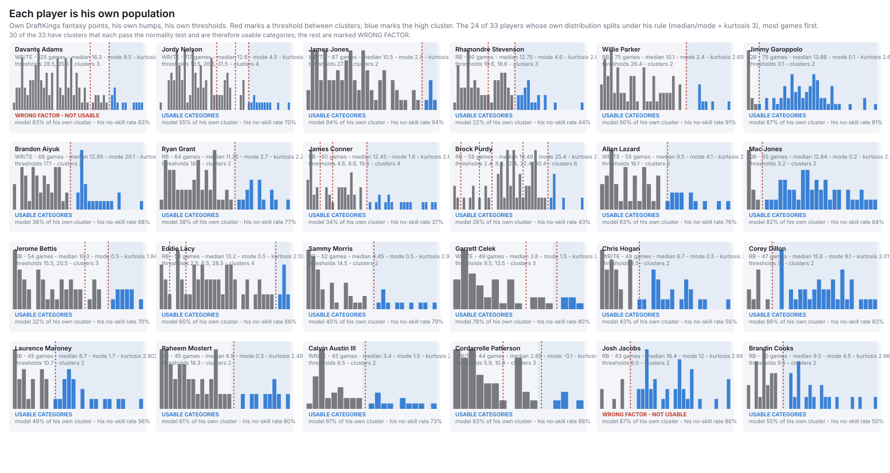
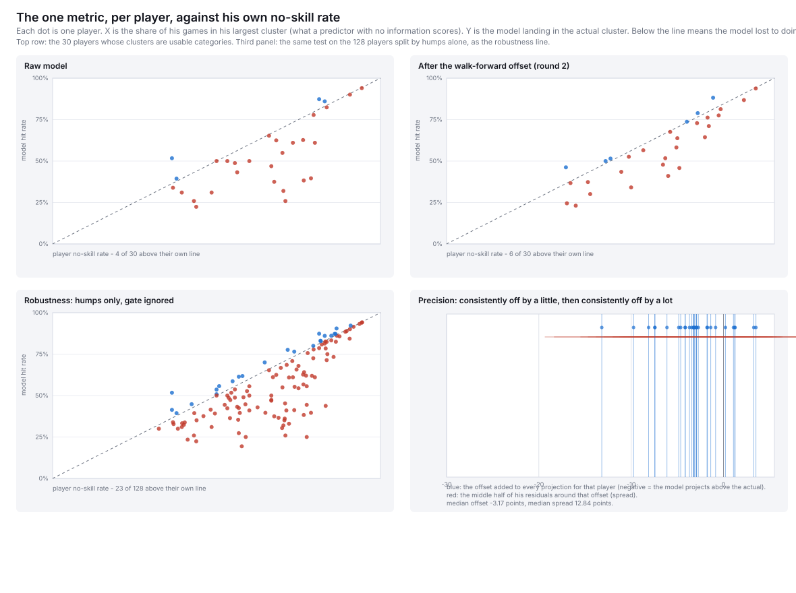

# The per-player evaluation: Dave's method, run as written

Built by mavis. Date: 2026-11-23. The engine under test is `frontend/react/src/lib/dave-projection.ts`. The method is `docs/DFS Projection Model.md`, verbatim, and this evaluation runs it as written.

**This document supersedes `docs/mavis-projection-evaluation.md`** (the 2026-11-22 control-limit rebuild). That file stays in the repository as a dated record of the framing it measured; it is not the current evaluation, and none of its numbers should be quoted as current.

## What was wrong with the previous evaluation

Six things, all of them in the evaluation, none of them in the engine:

1. **It pooled.** 16,000+ games across all players, all teams, all positions and all eras went into one sample. That is not IID. No average over it is representative of anything — it is the league's average fantasy score, a variable nobody is after.
2. **It measured closeness.** Band error and correlation ask how near the number landed. The metric is precision: did this projection equal this actual on this day, on this day, on this day — reduced to a proportion, with the offset-and-measure calibration loop run again and again.
3. **It led with test statistics.** The p-value is the thing. And in this kind of work significance is an early analytical step, not the final validation.
4. **It used the wrong words.** A boom is an outlier beyond the upper limit; it can never be a small number. The upper cluster is a **high game**. That confusion killed the arithmetic.
5. **It reported "+0.8" as a points lift.** It was a percentage-point lift in the boom-calling rate.
6. **It took thresholds from a control-limit band.** His thresholds come from each player's own histogram — the humps and the valleys between them — and the factor comes from the multimodal anomalies, which is the population his step 8 describes.

This evaluation runs his eleven steps as written, one population per player, and reports p-values.

## The method, as executed

| his step | what ran |
|---|---|
| 1. pick a player | every player with at least 30 games of record becomes his own population; his games are never pooled with anyone else's |
| 2. take all his games over the range | every game of record for that player, all seasons |
| 3. histogram the key metric | 1-point bins over his own DraftKings fantasy points |
| 4. observe it and run descriptive statistics | mean, median, mode, SD, IQR, skew and kurtosis, per player |
| 5. skewness and one-off spikes are normal; multiple modes are the finding | hump detection with a published rule: a peak needs at least 2 games and 3 games of mass, and a valley has to fall to at most half the smaller neighbouring peak |
| 6. read the thresholds off the histogram | one threshold per valley between humps |
| 7. each threshold must be a hump behaving normally in isolation | every cluster is tested on its own: skew is fine (lognormal, resolvable with a constant), a still-bimodal cluster means the factor is wrong and the categories are not usable |
| 8. evaluate the thresholds for common cause | candidate causes: opponent, team, month, decade — each player-condition pair tested separately with a two-proportion z-test, never pooled across a player's different conditions |
| 9. derive and validate the factor by plotting and testing for normality | the cause's subset is tested for normality; the cause holds only if the subset is normal or skewed, never bimodal |
| 10. test against the recent boom game, run the calculation, project, then evaluate the next week | walk-forward: thresholds and the offset are re-derived from games already seen and applied to the next game; every game is categorised, never dropped |
| 11. repeat for players 2 through 7000 | 186 players in this run; the table grows by adding each week's players |

### The gate

His bonus rule, in his order. Match the median to the mode: if they are statistically similar the curve is normal and the player is one population. If they differ, check kurtosis — 3 is normal, low (platykurtic) means bimodal, high with skew means a lognormal that a constant resolves.

Implemented as: median and mode within 0.5 robust sigma → one population. Otherwise kurtosis against 3: at or above 3 → one population (lognormal or heavy tail, resolvable with a constant); below 3 → split at the valleys.

On 186 players — 10,961 games of record, 10,217 evaluations — that gives **153 one population and 33 split**. The two free constants are published and swept below, because the population is sensitive to one of them.

### The population this evaluation measures on

Of the 33 split players, **30 have every cluster passing the normality test** — 30 players, 1,579 games, 1,459 evaluations. That is the population where his categories are usable, and it is where the one metric is measured.

Three split players are **rejected as wrong factor** — their upper cluster is still bimodal, which by his own rule means the cause has not been found, so the categories cannot be used:

| player | games | thresholds | what failed |
|---|---|---|---|
| Davante Adams | 125 | 28.5, 35.5 | the top cluster (n=12) is bimodal |
| Josh Jacobs | 43 | 8 | the top cluster (n=37) is bimodal; the bottom cluster has 6 games, untestable |
| Aaron Hernandez | 36 | 15.8 | the top cluster (n=12) is bimodal |

A further 12 split players have at least one cluster with fewer than 8 games — under-powered, not wrong. They are kept in the population and flagged.

### The robustness line

Because the gate has a free constant in it, the same measurement is repeated on **128 players split on the humps alone, gate ignored** (122 of them with valid clusters). If the verdict changes between the two lines, the verdict is an artefact of the gate and not a fact about the model. It does not.

### Gate sensitivity

Split players / usable-category players, by the two constants:

| kurtosis cut | median/mode band 0.25σ | 0.5σ | 0.75σ | 1.0σ |
|---|---|---|---|---|
| 1.5 | 0 / 0 | 0 / 0 | 0 / 0 | 0 / 0 |
| 2.0 | 2 / 2 | 2 / 2 | 1 / 1 | 0 / 0 |
| 2.5 | 11 / 11 | 10 / 10 | 7 / 7 | 2 / 2 |
| **3.0** | 38 / 34 | **33 / 30** | 17 / 17 | 3 / 3 |
| 3.5 | 58 / 51 | 50 / 46 | 25 / 25 | 5 / 5 |

The cut at 3 is his own stated normal reference, so the headline row is 33 / 30. The sweep says two things plainly: the population is **nearly insensitive to the median/mode band** and **sensitive to the kurtosis cut** — at 2 it nearly vanishes, at 3.5 it is 50. The headline figures do not depend on a tuned constant, but they do depend on his stated reference being right. If the reference is wrong, the population moves.

## The one metric

His metric: **did this projection equal this actual on this day?** On this day. On this day. From which you calculate a proportion.

Implemented as: the projection lands in the same cluster as the actual. The proportion over one player's evaluations is that player's score.

The reference is the player's **own no-skill rate** — the share of his own games that fall in his majority cluster, which is exactly what a predictor with no information about the game scores. Never a flat 50%. The rates are aggregated as a distribution of per-player proportions, one number per player, never pooled.

### Metric population — 30 players, every cluster a usable category

| predictor | median hit rate | Q1 | Q3 | players beating their own reference |
|---|---|---|---|---|
| **model** | **0.500** | 0.377 | 0.627 | 4 / 30 |
| plain prior-games average | 0.655 | 0.413 | 0.770 | 6 / 30 |
| calibrated (after the walk-forward offset) | 0.546 | 0.441 | 0.735 | 6 / 30 |
| walk-forward thresholds | 0.457 | 0.277 | 0.586 | 9 / 29 |
| **the player's own no-skill rate** | **0.679** | 0.508 | 0.783 | — |

Paired per player, against each player's own reference. Sign test is an exact binomial on the above/below counts; Wilcoxon is the signed-rank test with a tie correction and a normal approximation.

| predictor | median difference | above | below | tied | sign test p | Wilcoxon p |
|---|---|---|---|---|---|---|
| **model** | **-0.092** | 4 | 25 | 1 | **0.0001** | **0.0002** |
| plain prior-games average | -0.0175 | 6 | 24 | 0 | 0.0014 | 0.0034 |
| calibrated | -0.047 | 6 | 24 | 0 | 0.0014 | 0.0003 |
| walk-forward thresholds | -0.232 | 9 | 20 | 0 | 0.0614 | 0.0009 |

**Read.** On the population where his own categories are usable, the model's projection lands in the actual's cluster **half the time**, against a no-skill rate of 0.679 and a plain prior-games average of 0.655. It beats its own reference on 4 players of 30 and falls below it on 25. The sign test puts that at p = 0.0001 and the signed-rank test at p = 0.0002: the model is measurably worse than doing nothing, on the population his method defines.

The plain average is also below the reference (p = 0.0014 / 0.0034), so the reference is a hard line, not a formality — and the model is still well behind it.

The walk-forward-threshold variant is the one place the two tests disagree, and the disagreement is informative: 9 players beat their reference but by a median 0.232 below it, so the sign test (which ignores magnitude) reads p = 0.0614 while the signed-rank test (which does not) reads p = 0.0009. It is worse by degree, not clearly by sign.

### Robustness line — 128 players split on the humps alone

| predictor | median hit rate | Q1 | Q3 | median difference | above / below / tied | sign test p | Wilcoxon p |
|---|---|---|---|---|---|---|---|
| model | 0.532 | 0.395 | 0.752 | -0.0685 | 23 / 104 / 1 | 0.0001 | < 0.0001 |
| plain prior-games average | 0.666 | 0.484 | 0.794 | -0.0165 | 33 / 93 / 2 | 0.0001 | < 0.0001 |
| calibrated | 0.605 | 0.446 | 0.774 | -0.0525 | 23 / 105 / 0 | 0.0001 | < 0.0001 |
| walk-forward thresholds | 0.456 | 0.333 | 0.611 | -0.2245 | 25 / 65 / 0 | 0.0001 | < 0.0001 |
| the player's own no-skill rate | 0.702 | 0.548 | 0.797 | — | — | — | — |

Same direction, same order, both tests significant at p < 0.0001. The verdict does not depend on the gate.

## Precision: the calibration loop

His loop is offset → measure → repeat. The model's offset per player is re-estimated from games already seen and applied to the next game, and the metric is measured again.

| population | residual offset (median) | Q1 | Q3 | residual IQR (median) | share within ±2 points of the offset |
|---|---|---|---|---|---|
| metric population (30 players) | -3.17 | -4.513 | -1.47 | 12.84 | 0.158 |
| robustness line (128 players) | -2.343 | -4.197 | -0.013 | 11.426 | 0.189 |

The residual is actual minus projection, and the offset is **added** to the projection. A negative offset means the model projects above the actual — it does, for **24 of the 30** players, by a median 3.17 DK points. That is a systematic, correctable bias, not noise.

Calibration is worth having and it is not worth enough: it raises the hit rate for 18 of the 30 players and lowers it for 12, moving the median from 0.500 to 0.546 — still below the 0.679 no-skill rate. The spread is the part that resists: a median residual IQR of 12.84 points around the offset, with only 15.8% of residuals landing within 2 points of it. The model is consistently off by a little, then consistently off by a lot.

## Aim: does the call point where it should

| population | P=1 projections | landing in the upper cluster | P=0 projections | landing in the lower cluster |
|---|---|---|---|---|
| metric population | 907 | 522 (0.576) | 334 | 254 (0.76) |
| robustness line | 4,031 | 1,959 (0.486) | 1,870 | 1,502 (0.803) |

The low side is sound. The high side is not: when the engine calls the high side, its projection lands in the player's upper cluster **48.6%** of the time on the robustness line and 57.6% on the metric population.

The reason is mechanical, and it is the single most important finding in this document. The engine's P=1 projection is **exactly** its upper control limit — median difference 0, max difference 0 over 7,990 P=1 rows — and that limit is the mean of the **high half**, formed by the median split. For a bimodal player the high half contains the upper cluster *plus* the upper part of the lower cluster, so its mean sits below the upper cluster's centre. The projection is therefore aimed at a logistics quantity while the categories are populations.

Measured against the upper cluster's mean, the P=1 projection sits a median **-6.047** points away (p10 -14.961, p90 1.606). It is above the upper-cluster mean on only 13.5% of P=1 rows, and more than 5 points above it on 0.9%. The P=0 side, aimed at the lower half's mean, is a median -0.009 from the lower cluster's mean and lands in the lower cluster 80.3% of the time.

**A boom is unreachable by construction.** The engine can never project a genuine outlier of the upper limit, because the only number it can return on the high side is the high half's mean.

## The factors — his steps 8 and 9

Candidate causes are tested one player-condition pair at a time with a two-proportion z-test: does the condition hold when the game is in the standout tail, and not hold otherwise. A cause that clears p < 0.05 is then validated by testing its subset for normality — skew is fine and resolvable with a constant, bimodal means the factor is wrong.

Across all 186 players, **82 have at least one cause at p < 0.05, and 29 of them have a cause that also passes the normality test.**

| cause kind | causes at p < 0.05 | of those, pass the normality validation |
|---|---|---|
| opponent | 71 | 7 |
| month | 29 | 12 |
| team | 18 | 9 |
| decade | 16 | 13 |

The holding rate differs sharply by kind, and that is a result, not noise: a decade or a team splits a career into regimes that can each be one population, while an opponent is much more likely to be a coincidence.

In the metric population, 12 of the 30 players have a cause at p < 0.05 and **6 of the 30 have one that passes the validation**:

| player | cause | p | standout share with / without | subset verdict |
|---|---|---|---|---|
| Rhamondre Stevenson | opponent=MIA | 0.0117 | 0.091 / 0 | skewed, lognormal — resolvable with a constant |
| Jimmy Garoppolo | month=11 | 0.0392 | 0.133 / 0.017 | normal — factor holds |
| Brandon Aiyuk | month=9 | 0.0382 | 0.077 / 0 | skewed, lognormal — resolvable with a constant |
| Ryan Grant | opponent=CHI | 0.0077 | 0.125 / 0 | normal — factor holds |
| Allen Lazard | month=9 | 0.0251 | 0.2 / 0.022 | normal — factor holds |
| Sammy Morris | decade=2000 | 0.0452 | 0.237 / 0 | normal — factor holds |

**The p-value alone does not find the factor.** For 8 of the 12 metric-population players with a cause at p < 0.05, the *smallest-p* cause is not the one that survives validation — it is the wrong factor, or it has too few games to test. Jimmy Garoppolo's best cause is opponent=ARI at p = 0.0001, and its subset has 6 games and cannot be tested; the cause that holds is month=11 at p = 0.0392. Rhamondre Stevenson is the same shape: month=1 at p = 0.0001 with 5 games, against opponent=MIA at p = 0.0117 with 11 games that validate. His step 9 is not optional. Picking the smallest p-value would put the wrong factor into the model.

## The engine's own factor, against a measured null

The engine picks its factor by scanning every factor key for the best |t| between the kept high and low halves, with a |t| floor of 2.0 and no multiplicity control across keys. That is testable: take each player-condition pair the engine actually applied and ask whether the condition is associated with the player's **own upper cluster**.

**177 player-condition pairs** are testable from the evaluation CSV. **16 clear p < 0.05 — 9.0%.**

To read that number, the same test was run on random conditions of the same shape drawn from the same players: **77 of 1,335 cleared, 5.8%.** Expected by chance at that rate: 10.2 of 177. The engine's 16 against an expectation of 10.2 gives a **binomial one-sided p = 0.0510**.

**The engine's factor is not distinguishable from chance.** Not "weakly distinguishable" — at the 5% level it is not distinguishable at all, and the median p-value of the engine's own conditions (0.4416) is no better than the median p-value of the random ones (0.4626).

Six of the 16 rest on a cell with fewer than 5 games, where a two-proportion test is not stable; 10 have both cells at 5 or more. The condition kinds tested are opponent (155) and team (22).

### What the CSV can and cannot test

| rows | count |
|---|---|
| total rows of record | 25,104 |
| no condition at all | 7,509 |
| even-split floor (no factor found) | 3,650 |
| testable opponent / team / month condition | 9,619 |
| raw-average path (a prose condition, not a factor) | 1,430 |
| factor path | 12,515 |

The engine also applies `regimeShifts` (1,251 rows), `restDays` (967 rows) and `isHome` (678 rows). **None of those three is in the evaluation CSV**, so those rows apply a factor the CSV cannot re-evaluate at all. That is a gap in the data, not a finding about the factor.

## Where the engine departs from his document

The evaluation measures the model as implemented. These are the places where the implementation and `docs/DFS Projection Model.md` are not the same thing. None of them has been changed — the engine was not touched.

**1. The P=1 projection targets the high half's mean, not the high cluster's mean.** The engine's `control_high` is `proj.highMean`, the mean of the high half after peeling. That is a control limit, and the high half is logistics — the top half of the games by median split. His categories are populations: the clusters his histogram produces. For a bimodal player the two are different numbers, and the model's target is the wrong one. Evidence: P=1 projection minus control_high is 0 at the median and at the maximum over 7,990 rows; P=1 projection minus the upper cluster's mean is a median -6.047. **The arithmetic is not the problem; the target is.**

**2. The factor is derived from the halves, never from the peeled anomalies.** His step 8 is explicit: with the multimodal anomalies removed, *investigate that data* for a common thread — the anomalies are a different population, so there is a factor, and you look for what they share. The engine computes the peeled set, returns it, and never uses it for discovery. Its factor comes from the best |t| between the kept high and low halves instead, which is a different question with no multiplicity control. The measured null above is what that costs.

**3. The formula is additive in the document and a weighted blend in the engine.** His document: "High scoring: high Outlier group average x (% probability of occurrence in upcoming game) + normal outlier group average x (1 - % prob)" and "Low scoring: low Outlier group average x (% prob of occ in upcoming game)", with the worked example "if it's a home game, you multiple his home scoring outlier average by 1 ... and use that number to add to the low scoring number." That is additive. The engine computes `highMean * p + lowMean * (1 - p)`, a weighted blend — one number on the segment between the two half means. The two readings agree at the even-split floor (p = 0.5) and disagree everywhere else. At p = 1 the additive reading returns the high-side contribution *plus* the low-side contribution, which is how his document says you "get access to boom or bust games"; the blend returns the high half's mean alone, which is why a boom is unreachable. **This one needs his ruling before the engine changes** — it is a spec question inside his own document, not a bug I can fix on my own.

**4. The probability weighting is computed and never used.** `highFraction` and `lowFraction` are calculated and returned inside `factorDetail`, and nothing feeds them into the projection. The document's probability-of-occurrence weighting is not implemented. Where the applied condition's state is known the engine's P is exactly 1 or 0; where it is not, P is the even-split floor. That is his "using the average category only when you're uncertain" rule, faithfully implemented — but the continuous weighting the document describes is absent.

**5. A column in the evaluation CSV is named like a mean and holds a count.** `peeled_high` is the **number** of peeled outliers, not their mean. It is equal to `control_high` in 3 of 17,595 rows, and the median difference between them is +14.6, which is a meaningless number dressed as a points difference. Any comparison of a projection against `peeled_high` is apples to oranges. This evaluation does not make that comparison; the CSV should rename the field and the old document's use of it should be marked.

## Boom and high game, corrected

The old evaluation's label was "boom (outlier high)", applied when the actual exceeded the high half's mean. Under his vocabulary that is not a boom at all: it is a high game at best, because a boom is an outlier beyond the upper **limit**.

Re-reading the old label on the engine's contemporaneous basis — thresholds re-derived from the games already seen, the same basis the engine used — over the 5,767 evaluations where the player's earlier games had a second hump:

| | count | share |
|---|---|---|
| high game (in the upper cluster) | 1,897 | 32.9% |
| **genuine boom (beyond the upper limit)** | **137** | **2.4%** |
| ordinary | 3,733 | — |

And the 1,336 rows the old evaluation called booms, re-read on that same basis:

| | count | share |
|---|---|---|
| really a **high game** | 1,023 | **76.6%** |
| really a **genuine boom** | 137 | 10.3% |
| ordinary games | 176 | 13.2% |

**Three quarters of the old booms were high games.** The sizes say the same thing: the old "boom" sits a median **3.25** points above the upper cluster's median (p10 -5.075, p90 13.3), while a genuine boom sits a median **15.6** points above it (p10 9.792, p90 24.13). A +0.8 lift is not an outlier of anything.

Retrospectively, over the old label's 1,743 rows for players who have an upper cluster: 1,267 land in the upper cluster, 67 are beyond the upper limit, and 168 are isolated spikes. The old label's actual minus the upper cluster's mean has a median of **-1.125** (p10 -11.56, p90 8.941) — the old "booms" were, on average, *below* the upper cluster's mean, because the old threshold was the high half's mean.

**On the "+0.8".** It was a percentage-point lift in the boom-calling rate (46.3% against a 45.5% reference), not a points lift over the high mean, and it was measured on a pooled-games population. On the per-player population with the right vocabulary, the model's high-side call lands in the player's upper cluster 48.6% of the time and lands above the upper cluster's mean on 13.5% of P=1 rows. There is no boom edge to lift.

## The charts

**Each player is his own population** — 24 panels of the 33 split players' own histograms, in 1-point bins, with the thresholds in red, the high cluster shaded, and each panel marked USABLE CATEGORIES or WRONG FACTOR — NOT USABLE. Rendered at 1552×826; the PNG render is alongside it.

**The one metric, per player, against his own no-skill rate** — the raw model, the model after the walk-forward offset, the robustness line, and the precision panel showing each player's offset and the spread around it. Rendered at 1180×880; the PNG render is alongside it.

Both SVGs parse as well-formed XML, carry no NaN or undefined text, and were rasterised at their exact canvas size and measured pixel by pixel: 72.08% and 29.21% non-white coverage, ink spanning the full canvas, no overflow into the bottom-right corner.

## What this data cannot settle

His step 8 names the causes to test: opponent, team, age, injury, surrounding cast, contract year, month. The evaluation CSV carries **opponent, team, date and season only**. Age, injury status, minutes played, contract year and surrounding cast are not in it, and neither are the defensive rankings, the sacks leader or the rookie tackle his document lists as examples. So step 8 could be executed on four candidate kinds, not on the set he named.

The engine's own `isHome`, `restDays` and `regimeShifts` factors are in the same position from the other side: 1,251, 967 and 678 rows apply a factor the CSV cannot re-evaluate.

Those are gaps in the data. They are surfaced here, not filled with estimates.

## The verdict

1. **His premise holds on the data.** Thresholds do form. 33 of 186 players split into clusters under his own gate, and 30 of those have every cluster behaving normally in isolation, so the categories are real and usable. The method is not empty.
2. **On the one metric, against each player's own reference, the model does not beat the reference and does not beat a plain prior-games average.** Median hit rate 0.500 against a 0.679 no-skill rate and a 0.655 average; 4 players of 30 beat their own reference, 25 fall below it; sign test p = 0.0001, Wilcoxon p = 0.0002. The same verdict, same order and both tests significant at p < 0.0001 on the 128-player robustness line.
3. **The reason is in the engine, not in the data.** The engine's halves are logistics; his categories are populations. The P=1 projection equals the high half's mean exactly, which for a bimodal player sits a median 6.05 points below the upper cluster's mean, so the high call lands in the upper cluster less than half the time and a boom is unreachable by construction.
4. **The factor machinery is not yet distinguishable from chance.** 16 of 177 applied conditions clear p < 0.05 against a measured null of 5.8% — binomial p = 0.0510 — and the engine never looks at the peeled multimodal anomalies, which is where his step 8 says the factor comes from.
5. **The precision loop works and works in his direction, but it is not enough.** The model over-projects for 24 of the 30 players by a median 3.17 points; the offset corrects that and lifts the hit rate from 0.500 to 0.546. The spread resists it: a median residual IQR of 12.84 points, with only 15.8% of residuals within 2 points of the offset.
6. **His own p-value rule would have picked the wrong factor 8 times out of 12.** The cause with the smallest p-value is the wrong factor or untestable in 8 of the 12 metric-population players that have one. The normality validation in step 9 is what finds the real cause.

## The per-player table — the 30 usable-category players

The cause column is the strongest cause at p < 0.05, which is not always the cause that survives validation — see the factor section.

| player | pos | games | thresholds | model | calibrated | baseline | his no-skill rate | offset | residual IQR |
|---|---|---|---|---|---|---|---|---|---|
| Jordy Nelson | WR/TE | 117 | 19.5, 26.5, 31.5 | 0.549 | 0.582 | 0.69 | 0.701 | 1.257 | 15.319 |
| James Jones | WR/TE | 87 | 27.5 | 0.94 | 0.938 | 0.94 | 0.943 | -3.171 | 14.349 |
| Rhamondre Stevenson | RB | 80 | 10.6, 18.6 | 0.224 | 0.301 | 0.355 | 0.438 | -2.979 | 16.667 |
| Willie Parker | RB | 75 | 26.4 | 0.901 | 0.868 | 0.901 | 0.907 | -9.746 | 17.234 |
| Jimmy Garoppolo | QB | 75 | 3.1 | 0.873 | 0.882 | 0.859 | 0.813 | -1.744 | 10.534 |
| Brandon Aiyuk | WR/TE | 68 | 17.1 | 0.375 | 0.41 | 0.672 | 0.676 | -2.917 | 16.521 |
| Ryan Grant | RB | 64 | 18.7 | 0.383 | 0.789 | 0.75 | 0.766 | -6.129 | 13.723 |
| James Conner | RB | 60 | 4.6, 8.6, 19.6 | 0.339 | 0.245 | 0.518 | 0.367 | 3.516 | 14.066 |
| Brock Purdy | RB | 58 | 2.4, 8.4, 12.4, 22.4, 30.4 | 0.259 | 0.373 | 0.333 | 0.431 | 3.277 | 13.494 |
| Allen Lazard | WR/TE | 55 | 16.1 | 0.627 | 0.729 | 0.765 | 0.764 | -4.15 | 8.472 |
| Mac Jones | QB | 55 | 3.2 | 0.824 | 0.813 | 0.824 | 0.836 | -3.221 | 9.193 |
| Jerome Bettis | RB | 54 | 15.5, 20.5 | 0.32 | 0.638 | 0.68 | 0.704 | -3.687 | 11.477 |
| Eddie Lacy | RB | 53 | 2.5, 6.5, 28.5 | 0.653 | 0.478 | 0.653 | 0.66 | -1.787 | 15.089 |
| Sammy Morris | RB | 52 | 14.5 | 0.396 | 0.644 | 0.771 | 0.788 | -4.634 | 12.504 |
| Garrett Celek | WR/TE | 49 | 9.5, 13.5 | 0.778 | 0.762 | 0.778 | 0.796 | -1.379 | 7.419 |
| Chris Hogan | WR/TE | 48 | 8.5 | 0.432 | 0.341 | 0.409 | 0.563 | -7.443 | 14.475 |
| Corey Dillon | RB | 47 | 7.1 | 0.86 | 0.775 | 0.86 | 0.83 | -0.856 | 11.23 |
| Laurence Maroney | RB | 45 | 10.7 | 0.488 | 0.526 | 0.39 | 0.556 | -3.267 | 11.51 |
| Raheem Mostert | RB | 45 | 16.3 | 0.61 | 0.711 | 0.78 | 0.8 | -3.17 | 12.882 |
| Calvin Austin III | WR/TE | 45 | 8.5 | 0.61 | 0.737 | 0.756 | 0.733 | -3.442 | 8.02 |
| Cordarrelle Patterson | WR/TE | 44 | 5.9, 10.9 | 0.625 | 0.676 | 0.625 | 0.682 | 0.213 | 5.869 |
| Brandin Cooks | RB | 40 | 9.5 | 0.5 | 0.515 | 0.444 | 0.5 | -8.114 | 14.771 |
| Deion Branch | RB | 37 | 6.1, 12.1 | 0.394 | 0.367 | 0.394 | 0.378 | -4.85 | 14.221 |
| Darrius Heyward-Bey | WR/TE | 36 | 7.8 | 0.469 | 0.517 | 0.656 | 0.667 | -4.146 | 8.368 |
| DeAngelo Williams | RB | 33 | 6.4, 19.4 | 0.517 | 0.462 | 0.345 | 0.364 | -2.725 | 8.94 |
| Larry Fitzgerald | WR/TE | 33 | 9.9, 14.9 | 0.31 | 0.231 | 0.31 | 0.394 | -2.935 | 18.213 |
| Brandon Lloyd | WR/TE | 33 | 7.5, 12.5 | 0.31 | 0.5 | 0.345 | 0.485 | -13.183 | 12.36 |
| Jaylen Samuels | RB | 31 | 9.5, 13.5 | 0.259 | 0.458 | 0.481 | 0.71 | -7.429 | 12.797 |
| Carson Palmer | QB | 30 | 15.42 | 0.5 | 0.565 | 0.577 | 0.6 | 1.081 | 10.628 |
| Jeremy Kerley | WR/TE | 30 | 9.5 | 0.5 | 0.435 | 0.423 | 0.533 | 1.217 | 15.1 |

## The data under it

The evaluation runs over the same evaluation CSV the previous document used: **25,104 games of record across 2,527 players**, every completed player-game for the sampled teams (ne, gb, pit, sf; completed regular seasons 2002-2026), scored with DraftKings' published rubric. Of those, 186 players carry at least 30 games of record and form the population for the gate.

## Reproduction

Every figure in this document is extracted from the generated JSON by `dev/mavis-player-scoped-doc-facts.mjs`, which also scans every numeric token in this file and fails if any of them is not backed by the data. Run order:

`@
node frontend/react/scripts/mavis-csv-profile.mjs
node frontend/react/scripts/mavis-player-scoped-evaluation.mjs
node frontend/react/scripts/mavis-player-scoped-audit.mjs
node frontend/react/scripts/mavis-player-scoped-significance.mjs
node frontend/react/scripts/mavis-engine-factor-coverage.mjs
node frontend/react/scripts/mavis-engine-factor-significance.mjs
node frontend/react/scripts/mavis-boom-semantics.mjs
node frontend/react/scripts/mavis-boom-semantics-walkforward.mjs
node frontend/react/scripts/mavis-writup-numbers.mjs
node frontend/react/scripts/mavis-player-scoped-charts.mjs
node dev/mavis-player-scoped-doc-facts.mjs
`@

The engine was not modified by this work.
