# Projection evaluation: the model against a plain prior-games average, measured by control limits

Built by mavis. Walk-forward evaluation of Dave's projection model — the engine is `frontend/react/src/lib/dave-projection.ts`, implemented exactly as his document (`docs/DFS Projection Model.md`) specifies — against a plain prior-games baseline, on **every** game of record ESPN publishes for the sampled teams (ne, gb, pit, sf; completed regular seasons 2002-2026), scored with DraftKings' published rubric.

**Rebuilt 2026-11-22 (mavis).** This is the control-limit rebuild, and it replaces the earlier framing in this file. The 2026-11-08 version (revised 2026-11-14) measured the model by **categorizing** each game against the median split C and reporting agreement rates. That is not the yardstick the method is built on, so it has been replaced: every evaluation is now placed in the player's own **control-limit band**, **R** is the yardstick, a **boom** is an **outlier high** and a **bust** an **outlier low**, and the deliverable is **predictability** — how close the number landed and whether the call pointed at the right control limit.

The numbers changed and the verdict changed with them: the earlier "the two sides are a dead tie" reading does not survive the yardstick Dave's own method defines. The superseded charts are kept in `docs/shots/` (`mavis-eval-agreement.svg`, `mavis-eval-gap.svg`, `mavis-eval-agreement-before.svg`) as the record of the old framing; they are labelled as superseded and are not evidence for anything in this document.

## The headline numbers

Every rate below is tested against its **own** reference — never against a flat 50%. The references are defined in [the reference lines](#the-reference-lines).

| measure | model | plain prior-games average | read |
|---|---|---|---|
| **squared band error** (R units, lower is better) | **2.00** | **1.80** | the plain average lands closer to the actual |
| **correlation with the actual** | **0.015** | **0.182** | the plain average tracks the actual; the model barely tracks it at all |
| paired test on the same 17,593 rows | `` | `` | difference +0.194, paired t = 11.46 (df 17,592), p < 0.0001; sign-flip permutation p = 0.0001; correlation difference Fisher z = −15.85, p < 0.0001 |
| **boom** — points up when the actual is an outlier high | 46.3% (1,912 / 4,133) | 32.3% (1,334 / 4,133) | |
| boom — its own no-skill reference | 45.5% | 28.3% | |
| **boom lift** above its own reference | **+0.8 pts** (z = 1.04, permutation p = 0.1187) | **+4.0 pts** (z = 5.74, permutation p = 0.0001) | the model's boom edge is **not significant**; the plain average's is |
| **bust** — points down when the actual is an outlier low | 31.4% (1,562 / 4,978) | 38.9% (1,938 / 4,978) | |
| bust — its own no-skill reference | 28.7% | 36.0% | |
| **bust lift** above its own reference | **+2.7 pts** (z = 4.24, permutation p = 0.0001) | **+3.0 pts** (z = 4.37, permutation p = 0.0001) | both real, the plain average's slightly larger |
| the winning **factor**, out of sample | boom rate 23.9% when its condition holds vs 21.4% when it does not (12,515 rows) | — | **+2.5 pts, z = 3.22, p = 0.0013** — small, and real |
| the engine's **90% interval** | 58.5% contained (10,295 / 17,593) against its own 90% nominal, z = −139.19 | — | the interval is far from nominal; treat it as a relative line only |

**How to read this.** The model is a *direction instrument*, not a point estimator, and the two measures answer different questions. Its projection is `high mean × P + low mean × (1 − P)` — a point on the segment between the two control limits — so when a factor's condition holds (P = 1) the number sits exactly on the upper limit, and when it does not (P = 0) exactly on the lower limit. The plain average floats inside the band, where most actuals land. That is why the squared error favours the average and the correlation is near zero for the model: on the band-accuracy axis, landing in the middle of the band beats landing on an edge. It is not a defect in the arithmetic; it is what the formula does.

So the honest reading of this table is two separate statements, and both are true at once:

1. **Measured on how close the number landed, the plain prior-games average beats the model**, on every path, at every sample size, in every era.
2. **Measured on whether the call pointed at the right limit, the model's boom edge is not distinguishable from its own reference** (+0.8 pts, z = 1.04, permutation p = 0.1187), while the plain average's boom edge is (+4.0 pts, z = 5.74, p = 0.0001). On busts the model is +2.7 and the plain average +3.0 — both significant.

The one place the factor machinery earns its keep is out of sample and it is small: on the 12,515 factor-path evaluations, games where the winning condition holds became booms 23.9% of the time against 21.4% when it did not (two-proportion z = 3.22, p = 0.0013; χ²(1) = 10.3, p = 0.0013). The condition carries information. The magnitude is 2.5 points.

## What was evaluated (the counts)

- **25,104 games of record** — every completed player-game in the dataset, written to the CSV. Nothing omitted.
- **22,577 evaluations** — games with at least one earlier game.
- **2,527 first games of record** — a player's first game in the dataset: no earlier games, so no halves, no control limits, no projection. Recorded as information, not silence.
- **4,984 evaluations with no control limits yet** — fewer than 4 earlier games, so there are no halves to split and no limits to stand on. Recorded, not scored.
- **17,593 evaluations with control limits** — the scored population. Every number in this document that is a rate is over these 17,593 rows unless it says otherwise.
- **17,196 evaluations carry the [low-sample asterisk](#the-low-sample-asterisk)** (fewer than 30 earlier games) — still projected, still recorded.
- **5,381 evaluations at 30 or more earlier games** — the Central Limit Theorem threshold the owner set.
- **1,968 players evaluated** (at least one evaluation); **2,527 players seen** (at least one game of record).
- Data: **1,538 event summaries held (all planned)**, cached from the proven fetch layer and reused this run. This run made **2,068 requests** (100 schedules + 1,968 exact-position lookups), **0 failures**, **16 seconds**. Run stamp: `2026-11-22T13:15:16Z`.
- Positions, both counts labelled: QB = 3,382 evaluations by 250 players; RB = 6,629 by 562; WR = 7,910 by 700; TE = 3,684 by 337; FB = 923 by 85; refined ESPN lookups put small counts on P (33 by 17), PK (3 by 3), CB (6 by 3), OT (4 by 3), S (1 by 1), LB (2 by 1).

## The terms, in the owner's words

Each term is defined once, here, and used the same way everywhere. The words are not interchangeable: a child term inherits from its parent.

### game of record
One completed game for one player in the dataset: an ESPN box-score line, scored with DraftKings' published rubric (passing/rushing/receiving yards and touchdowns, receptions, fumbles lost, the 100-yard and 300-yard bonuses). Every game of record is written to the CSV.

### first game of record
A player's first game in the dataset. No earlier games, so no halves and no control limits exist for it. The CSV row says `first game of record (n=0)`.

### earlier games and earlier_n
For a target game: that player's completed games whose date is **strictly before** the target game's date, all seasons in the dataset, sorted by date. `earlier_n` is their count. An **evaluation** is a target game with earlier_n ≥ 1.

### the split (logistics)
The earlier games are split in half at the median: the LOW half takes the first ceil(n/2) games, the HIGH half the rest. This split is **logistics** — it is how the two halves are formed — and it is never reported as a rate, never compared between sides, and never used as a yardstick. The yardstick is R.

### control limits, and R
After the split, the engine peels the multimodal peaks that do not belong (at most two per half), then takes the mean of each half:

- **lower control limit** = the mean of the low half, post-peel
- **upper control limit** = the mean of the high half, post-peel
- **R, the control limit range** = upper control limit − lower control limit

R is the yardstick: everything in this document is measured in R units. Good players have tight limits; inconsistent players have wide ones. Across the 17,593 scored evaluations R runs from **0.1 to 33.6 DK points**, with a **median of 9.73**, mean 9.85, p10 4.19, p90 15.28.

### boom (outlier high), bust (outlier low), inside the band
Classified on the **actual** outcome against that evaluation's own control limits:

- **boom (outlier high)**: actual DK points **above** the upper control limit
- **bust (outlier low)**: actual DK points **below** the lower control limit
- **inside the band**: everything between the limits, including a game landing exactly on a limit — a tie on a limit does not break it

Counts over the 17,593 scored evaluations: **4,133 booms, 4,978 busts, 8,482 inside the band.** Booms and busts are separate populations, each with its own n. Never complements.

### band position
`(value − lower control limit) / R`. **0** is the lower control limit, **0.5** the midpoint of the band, **1** the upper control limit. Outside 0…1 is below the lower limit (bust) or above the upper limit (boom). Both the projection and the actual are placed in the same band, so the distance between them is measured in R.

### direction
Which control limit the call points at, from its band position: **up** above the midpoint, **down** below it, and **no call** exactly on the midpoint. The midpoint rule carries a tolerance of 1e-9, because the even-split floor and the equal-sized-halves raw average both land exactly on the midpoint and floating point puts them a hair either side of it. A projection on the midpoint points at neither limit, and that is a real state of the method, not a rounding artifact.

- model: **7,997 up, 5,042 down, 4,554 no call**
- plain average: **4,971 up, 6,326 down, 6,296 no call**

The plain average makes no call far more often, because when the two halves are the same size the average of all earlier games *is* the midpoint.

### P
P is the weight of the high half in the projection, and **in the engine it is binary**:

- **P = 1** — the winning factor's high-side condition holds for the upcoming game
- **P = 0** — it does not hold
- **P = 0.5** — the even-split floor, used when no factor's state is known for the upcoming game

The projection is the owner's formula: **high mean × P + low mean × (1 − P)**, and the even-split floor is his "half high half low = total projection".

> **Correction to the previous version of this document.** It described P as "the empirical frequency of the winning factor's high-side condition for that player". The engine never used the frequency, and the owner's document does not ask for one: "all conditionals are logical conditionals… the probability was external, and I turn it into a constant, a given", and "you're simply using actual observable fact to create binary, not continuous, outcomes". A home game is 1, not 0.62. Where the state is not knowable for the upcoming game the engine does not guess: it uses the even split. The engine was faithful; the previous description of it was not.

### model paths
Which rule produced the projection, recorded per evaluation:

- **factor** — a factor cleared the evidence floor (two-sample t-test, |t| ≥ 2) and its state is known for the upcoming game, so the formula is applied. **12,515** scored evaluations.
- **raw average (halves one population)** — the two halves are one population (Welch two-sample t, |t| < 2.1), so the projection is the raw average of the earlier games, the owner's definitional rule. P is not applied. **1,428** scored evaluations.
- **even-split floor (no factor's state known for this game)** — no factor's state is known for the upcoming game, so P = 0.5 and the projection is the balanced average of the two half means. **3,650** scored evaluations.
- **no control limits yet (n<4)** — fewer than 4 earlier games, so there are no halves. Recorded, not scored. **4,984** evaluations.

### the low-sample asterisk
Every game with earlier_n ≥ 1 gets a projection once there are 4 earlier games. Games with fewer than 30 earlier games are flagged in the `sample_flag` field ("low sample (n=12)") and are still projected and still counted. The 30-game line is the owner's Central Limit Theorem threshold; rows below it are asterisked, never dropped — omitting low-confidence games is bias.

### containment
For evaluations with an interval: **same** when the actual DK points fall inside the engine's 90% interval, **different** otherwise. Never called a miss. The interval is the engine's two-component mixture variance rebuilt at the evaluation's own P (within-half variances weighted by P and 1 − P, plus the between-half term P(1 − P)(highMean − lowMean)²), 1.6449 × sd on each side.

### the baseline
The plain prior-games average: the arithmetic mean of all earlier games. No split, no factor, no weighting, no outlier removal. It is placed in the same band as the model and scored on the same rows.

## Predictability: how close the number landed

Band error is the squared distance from the actual to the call, in R units. Correlation is between the call's band position and the actual's band position.

| scope | evaluations | band error, model | band error, average | correlation, model | correlation, average |
|---|---|---|---|---|---|
| all | 17,593 | **2.00** | **1.80** | **0.015** | **0.182** |
| factor path | 12,515 | 1.10 | 0.88 | 0.04 | 0.12 |
| raw average path | 1,428 | 4.19 | 4.08 | 0.03 | 0.24 |
| even-split floor | 3,650 | 4.23 | 4.08 | — (no variance) | 0.22 |
| earlier_n < 30 | 12,212 | 2.56 | 2.36 | 0.01 | 0.19 |
| earlier_n ≥ 30 | 5,381 | 0.73 | 0.53 | 0.05 | 0.05 |

The plain average lands closer on every row of that table. The paired test on the same 17,593 games: difference (model − average) **+0.194** in squared band error, paired t = **11.46** (df 17,592), p < 0.0001, confirmed by a sign-flip permutation (10,000 shuffles, seed 20261117): p = 0.0001. Correlation: 0.015 against 0.182, Fisher z = **−15.85**, p < 0.0001.

On the even-split floor the model's correlation is undefined rather than low: every one of those 3,650 projections is the midpoint, so the model has no variance to correlate with. The plain average still tracks the actual there (0.22).

## Direction: did the call point at the right control limit?

On a boom the call points up; on a bust it points down. Each side is scored against **its own** pointing rate over the same rows — what it scores carrying no information about the outcome.

| | model | plain average |
|---|---|---|
| points up | 7,997 (45.5%) | 4,971 (28.3%) |
| points down | 5,042 (28.7%) | 6,326 (36.0%) |
| no call | 4,554 | 6,296 |
| boom: points up | 1,912 / 4,133 = **46.3%** (reference 45.5%) | 1,334 / 4,133 = **32.3%** (reference 28.3%) |
| boom lift | **+0.8 pts**, z = 1.04, permutation p = **0.1187** | **+4.0 pts**, z = 5.74, permutation p = 0.0001 |
| bust: points down | 1,562 / 4,978 = **31.4%** (reference 28.7%) | 1,938 / 4,978 = **38.9%** (reference 36.0%) |
| bust lift | **+2.7 pts**, z = 4.24, permutation p = 0.0001 | **+3.0 pts**, z = 4.37, permutation p = 0.0001 |
| mean excess above the limit, when pointing up on a boom | +0.77 R | +1.11 R |
| mean excess below the limit, when pointing down on a bust | +0.31 R | +0.33 R |

**The model's boom edge is not significant.** +0.8 points above its own reference, z = 1.04, two-sided p = 0.2967, one-sided permutation p = 0.1187. The plain average's boom edge is significant at +4.0 points, z = 5.74. On busts both are real and the plain average is slightly ahead.

On the same rows, the model and the plain average point the right way on different games: on booms the model is right where the average is not on **1,194** games and the average is right where the model is not on **616** (McNemar's test χ²(1) = 184.58, p < 0.0001); on busts, the model on **883** and the average on **1,259** (χ²(1) = 66, p < 0.0001). The two are not the same instrument.

Permutation p is one-sided (the share of shuffled runs that scored at or above the observed rate, in the direction of the claim); the z-test p is two-sided. 10,000 shuffles, seed 20261117.

## Is the winning factor informative, out of sample?

The factor is chosen from the earlier games only, so these are out-of-sample rows: on the factor path, is a boom more common when the winning condition holds (P = 1) than when it does not (P = 0)?

| | rows | boom rate | bust rate |
|---|---|---|---|
| condition holds (P = 1) | 7,990 | **23.9%** (1,910) | 25.6% |
| condition does not hold (P = 0) | 4,525 | **21.4%** (968) | 30.9% |
| the factor path's own base rate | 12,515 | 23.0% | |

Difference **+2.5 points**, two-proportion z = **3.22**, p = **0.0013**; χ²(1) = 10.3, p = 0.0013. Small, and real: the winning condition does carry information about booms. The reference here is the factor path's own base rate — if the factor carried nothing, the two rows would match.

Which factors win, across the factor-path evaluations: opponent **6,301**, month **2,693**, regimeShifts **1,251**, restDays **967**, isHome **678**, team **625**. The engine's ranked-factor machinery makes the pool extensible — a new pre-game field is one more candidate key.

## The interval: containment against its own nominal

The engine's 90% interval contains the actual on **10,295 of 17,593** evaluations = **58.5%**, against its own nominal 90%: z = **−139.19**, p < 0.0001. The interval is far from nominal and anticonservative; treat containment as a relative line only, never as a 90% claim.

## Where the model's edge appears

**By the strength of the factor in sample** (|t| thirds, on the factor path):

| third | evaluations | median |t| | boom lift | bust lift |
|---|---|---|---|
| weakest | 4,171 | 2.52 | +1.3 pts | +3.4 pts |
| middle | 4,171 | 3.67 | +3.2 pts | +4.8 pts |
| strongest | 4,173 | 6.36 | +3.2 pts | +4.7 pts |

The strongest third buys **nothing** over the middle third. The in-sample t-statistic does not rank out-of-sample skill.

**By sample size:**

| group | evaluations | points-up rate | boom lift | bust lift | band error, model vs average |
|---|---|---|---|---|---|
| earlier_n < 30 | 12,212 | 35.0% | +0.5 pts | +2.7 pts | 2.56 vs 2.36 |
| earlier_n ≥ 30 | 5,381 | 69.2% | +2.4 pts | +2.7 pts | 0.73 vs 0.53 |

The boom edge appears only with 30 or more earlier games (+2.4 against +0.5). Bust lift is +2.7 either way. Under 30 games the model points up on barely a third of its rows.

**By era:**

| era | evaluations | median R | boom | bust | inside the band | band error, model vs average | boom lift | bust lift |
|---|---|---|---|---|---|---|---|---|
| 2002-2008 | 2,175 | 9.76 | 539 | 603 | 1,033 | 1.51 vs 1.38 | −0.3 pts | +5.4 pts |
| 2009-2014 | 4,708 | 10.31 | 1,112 | 1,347 | 2,249 | 1.70 vs 1.48 | +0.7 pts | +1.5 pts |
| 2015-2020 | 5,263 | 9.82 | 1,251 | 1,455 | 2,557 | 3.15 vs 2.94 | +2.8 pts | +2.7 pts |
| 2021-2026 | 5,447 | 8.97 | 1,231 | 1,573 | 2,643 | 1.34 vs 1.15 | −0.5 pts | +2.7 pts |

The model's boom lift is negative in the earliest and the most recent era and positive in the middle two. The bust lift holds in three of four eras.

**By position:**

| position | evaluations | median R | band error, model vs average |
|---|---|---|---|
| WR/TE | 8,266 | 8.68 | 1.68 vs 1.51 |
| RB | 6,560 | 9.65 | 2.36 vs 2.13 |
| QB | 2,767 | 11.74 | 2.08 vs 1.91 |

## Who has tight limits, who has wide ones

From the 159 players with 30 or more evaluations.

**Tightest bands** (R in DK points):

| player | position | evaluations | median R | band error, model vs average | boom / bust / inside |
|---|---|---|---|---|---|
| James Develin | RB | 34 | 2.64 | 1.30 vs 1.13 | 7 / 14 / 13 |
| Darnell Washington | WR/TE | 39 | 2.89 | 15.75 vs 14.89 | 17 / 7 / 15 |
| Michael Robinson | RB | 36 | 3.43 | 1.56 vs 1.16 | 10 / 8 / 18 |
| Bruce Miller | WR/TE | 52 | 3.60 | 1.29 vs 0.83 | 14 / 11 / 27 |
| Ted Ginn Jr. | WR/TE | 33 | 3.72 | 2.12 vs 1.82 | 10 / 10 / 13 |
| Ray-Ray McCloud III | WR/TE | 45 | 4.14 | 1.40 vs 1.25 | 12 / 10 / 23 |
| Marcedes Lewis | WR/TE | 50 | 4.15 | 0.72 vs 0.60 | 11 / 12 / 27 |
| Connor Heyward | WR/TE | 31 | 4.38 | 0.67 vs 0.61 | 7 / 14 / 10 |

**Widest bands:**

| player | position | evaluations | median R | band error, model vs average | boom / bust / inside |
|---|---|---|---|---|---|
| James Conner | RB | 56 | 18.66 | 126.37 vs 119.26 | 17 / 4 / 35 |
| Rob Gronkowski | WR/TE | 111 | 17.10 | 0.69 vs 0.50 | 31 / 24 / 56 |
| Randy Moss | WR/TE | 33 | 16.89 | 0.49 vs 0.40 | 2 / 13 / 18 |
| Martavis Bryant | WR/TE | 33 | 16.30 | 0.49 vs 0.39 | 2 / 10 / 21 |
| Wes Welker | RB | 67 | 16.08 | 0.83 vs 0.58 | 18 / 17 / 32 |
| Stefon Diggs | RB | 41 | 15.98 | 0.46 vs 0.39 | 6 / 11 / 24 |
| Willie Parker | RB | 71 | 15.82 | 1.12 vs 0.92 | 16 / 22 / 33 |
| Aaron Jones Sr. | RB | 97 | 15.74 | 0.57 vs 0.47 | 18 / 16 / 63 |

Darnell Washington's and James Conner's band errors are three orders of magnitude above everyone else's — a single extreme earlier game stretches the band far enough that a squared error in R units explodes. That is the metric behaving as it should on a stretched band, not a broken row, and it is why the per-player tables are read as R and boom/bust counts rather than as squared error alone.

## The charts

matplotlib is not installed and the spec says install nothing, so the charts are hand-rendered SVG artifacts (script: `frontend/react/scripts/mavis-evaluation-charts.mjs`). Colour rule: neutrals for structure, colour only where it means something — the control limits, the cut, level shifts and the no-skill reference marks are red (the statistical convention for the outlier boundary); everything else is gray.

### (a) Per-player games-of-record histograms, with the engine's own control limits

Five players, each selection rule recorded (the pool is players with ≥ 30 evaluations). The red lines are the engine's own control limits, computed by the engine's method on the games shown; R is the yardstick.

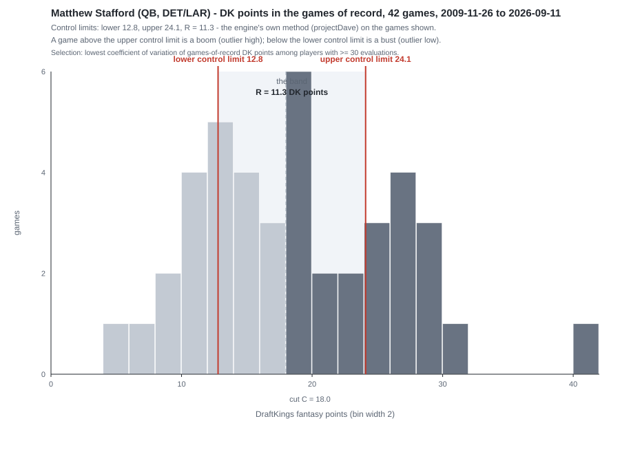

*Matthew Stafford (QB, DET/LAR) — 42 games of record, 2009-11-26 to 2026-09-11. Lower control limit 12.8, upper 24.1, R = 11.3; cut C = 18.0. Selection: lowest coefficient of variation of games-of-record DK points.*

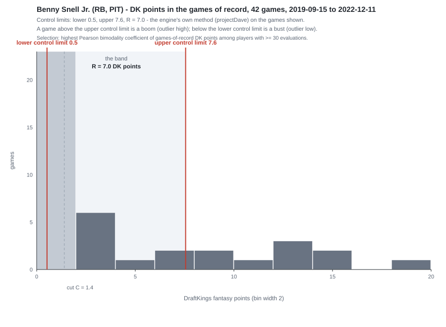

*Benny Snell Jr. (RB, PIT) — 42 games, 2019-09-15 to 2022-12-11. Lower 0.5, upper 7.6, R = 7.0; cut C = 1.4. Selection: highest Pearson bimodality coefficient — the boom/bust shape the method is built for.*

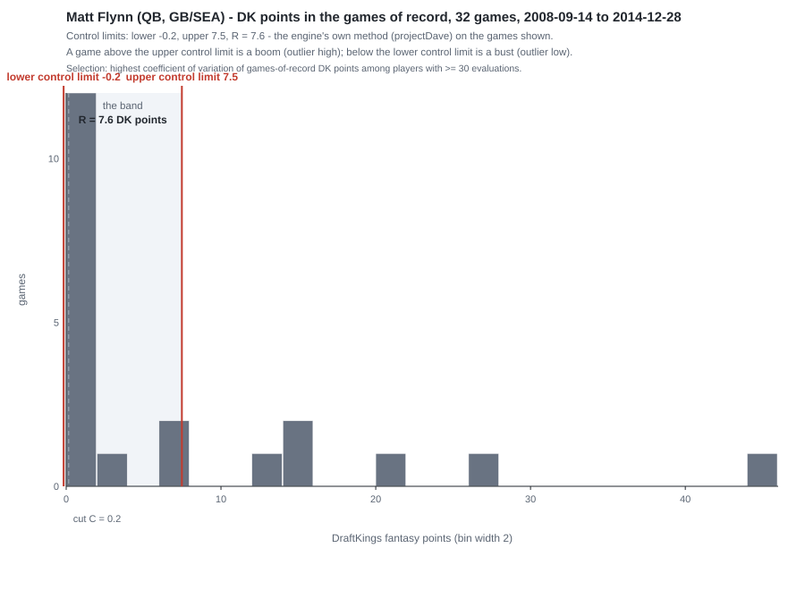

*Matt Flynn (QB, GB/SEA) — 32 games, 2008-09-14 to 2014-12-28. Lower −0.2, upper 7.5, R = 7.6; cut C = 0.16. Selection: highest coefficient of variation — mostly backup nights at near zero with a few spikes.*

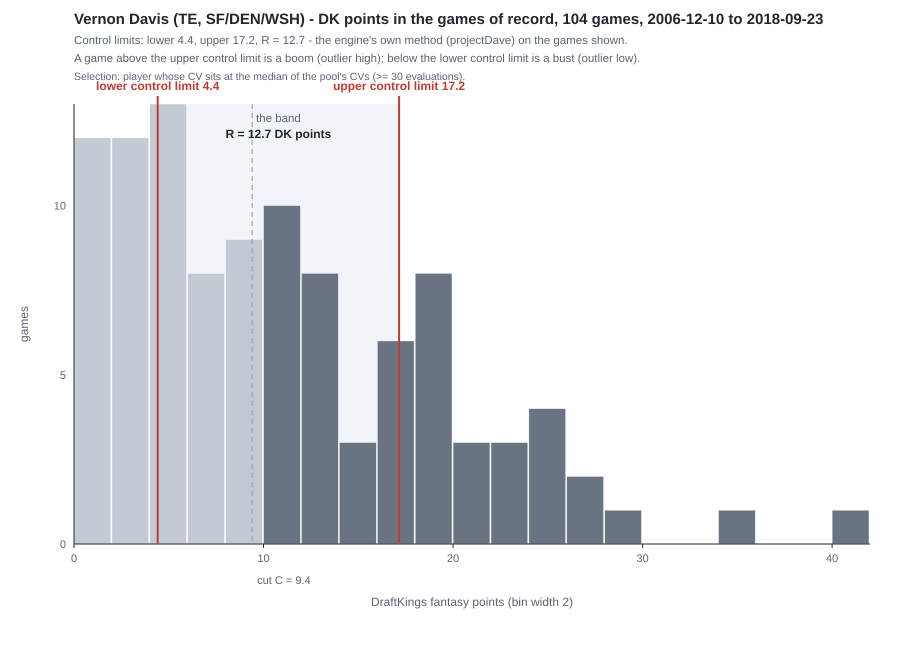

*Vernon Davis (TE, SF/DEN/WSH) — 104 games, 2006-12-10 to 2018-09-23. Lower 4.4, upper 17.2, R = 12.7; cut C = 9.4. Selection: CV at the median of the pool's CVs — the middle of the distribution of profiles. (This pick was Jerricho Cotchery in the previous version; the pool grew, and the median moved.)*

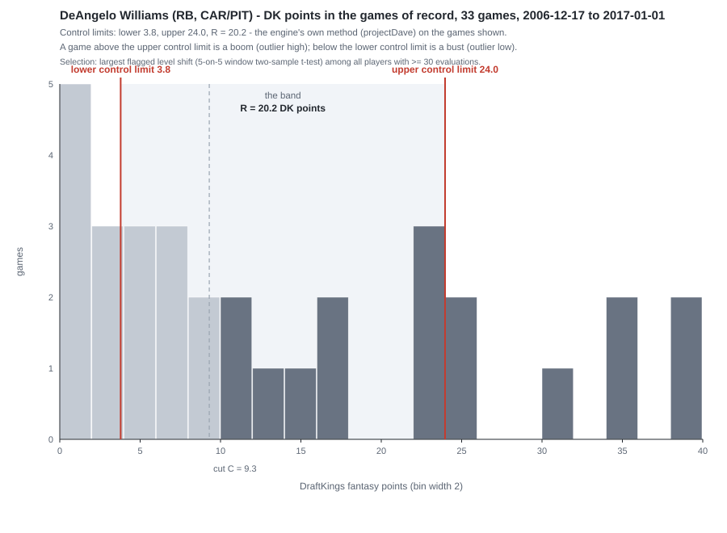

*DeAngelo Williams (RB, CAR/PIT) — 33 games, 2006-12-17 to 2017-01-01. Lower 3.8, upper 24.0, R = 20.2; cut C = 9.3. Selection: the largest flagged level shift in the dataset.*

### (b) Projection vs actual, identity line, interval band

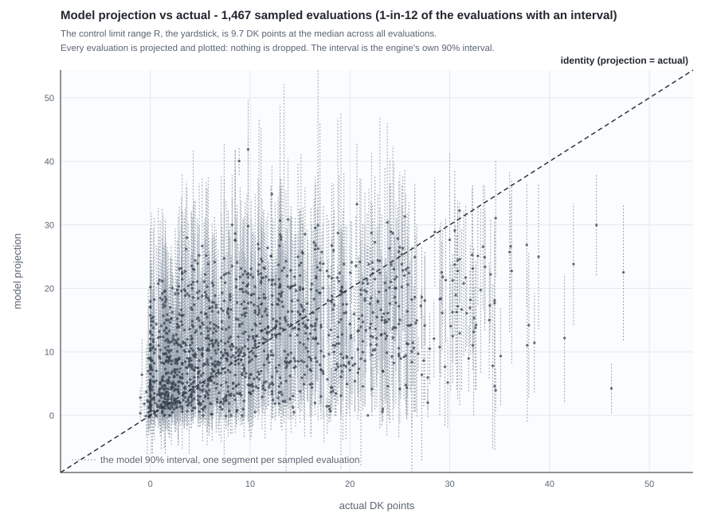

*1,467 sampled evaluations (a deterministic 1-in-12 of the 17,593 with an interval; the method is stated on the chart). The dashed gray vertical segments are the model's 90% intervals, the dots are the projections, the solid diagonal is the identity line. The control limit range R — the yardstick — has a median of 9.73 DK points across all evaluations.*

### (c) Direction: does the call point at the right control limit?

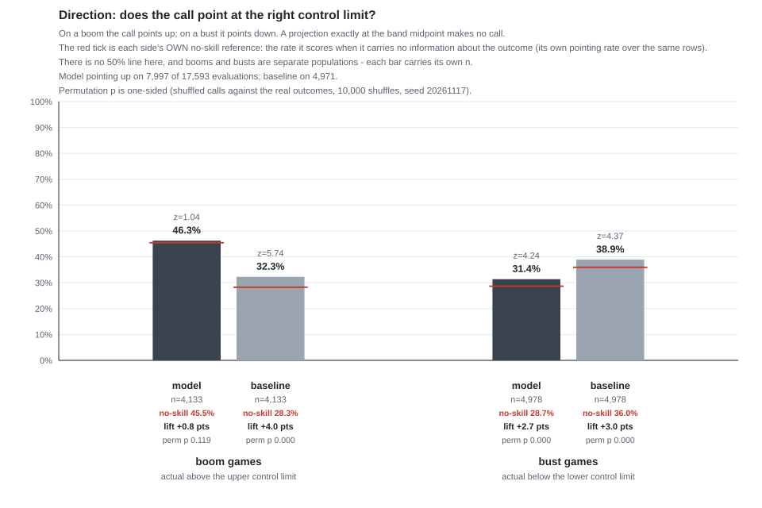

*The four rates from the direction table, each bar carrying its own n, its own red no-skill reference tick (that side's own pointing rate over the same rows), the z-test against that reference and the permutation p. There is no 50% line on this chart, and booms and busts are separate populations — each bar carries its own n.*

### (f) The same comparison with the lean removed

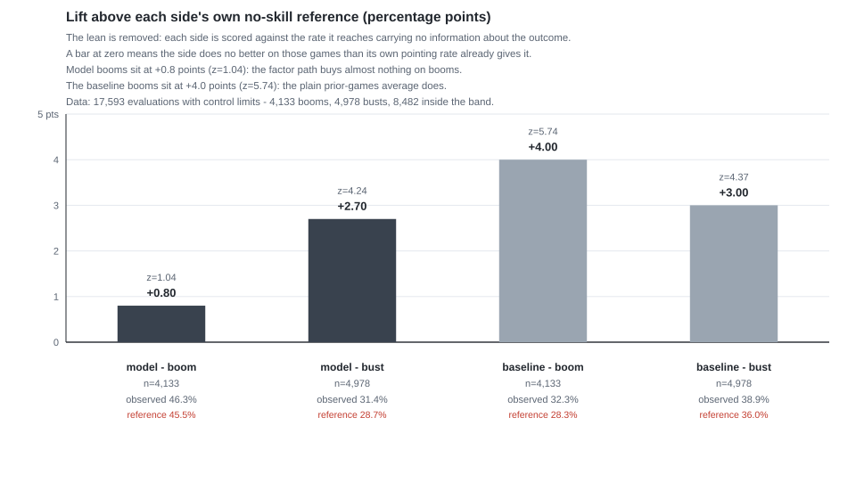

*Each bar is the observed rate minus that side's own no-skill reference, in percentage points. The model's booms sit at +0.8 points (z = 1.04, permutation p = 0.1187): the factor path buys almost nothing on booms. The plain average's booms sit at +4.0 points (z = 5.74, p = 0.0001).*

### (g) Band accuracy: how close the number landed

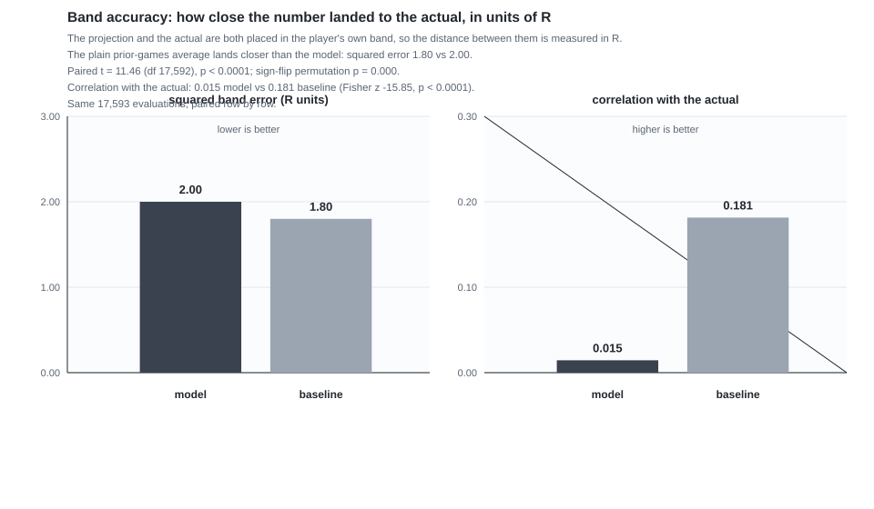

*Squared band error and correlation with the actual, on the same 17,593 evaluations: the plain prior-games average lands closer (1.80 vs 2.00) and tracks the actual better (0.182 vs 0.015).*

### (h) Is the winning factor informative out of sample?

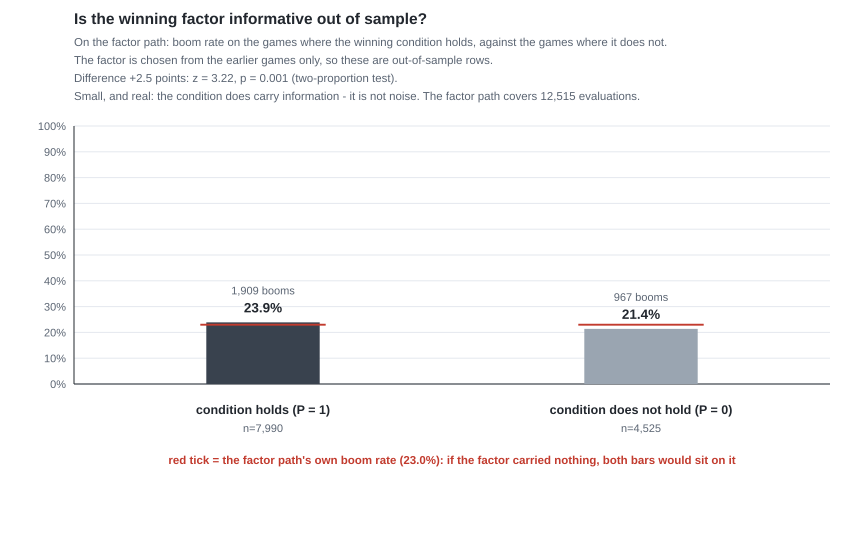

*Boom rate on the rows where the winning condition holds against the rows where it does not, with the factor path's own base rate as the reference: +2.5 points, z = 3.22, p = 0.0013.*

### (d) One regime-shift player's timeline, breakpoints marked

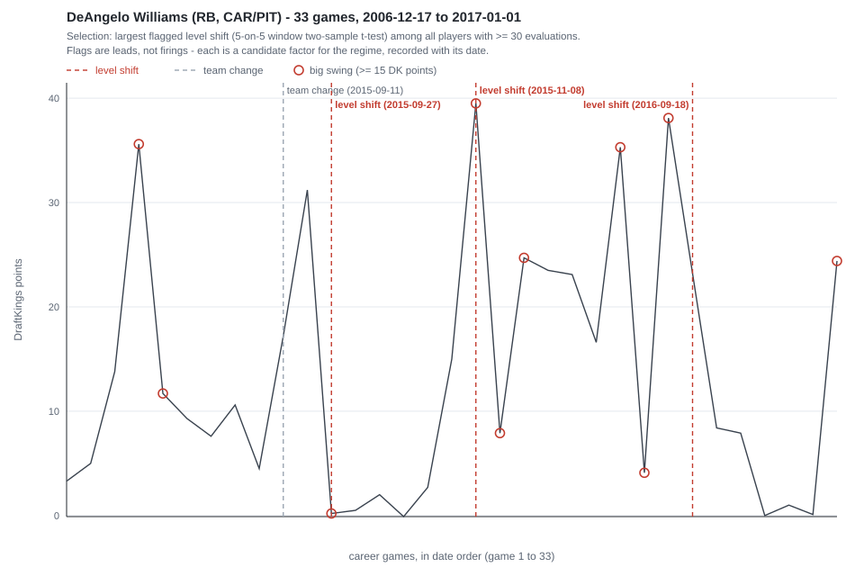

*DeAngelo Williams (RB, CAR/PIT) — 33 games of record, 14 breakpoint flags (3 level shifts: 2015-09-27, 2015-11-08, 2016-09-18; 1 team change: 2015-09-11; 10 big swings of ≥ 15 DK points). The flagged level shifts bracket his 2015 Pittsburgh stretch: 5-game mean 14.22 → 1.06 (flagged 2015-09-27), then 4.02 → 23.74 (flagged 2015-11-08) when he filled in for Le'Veon Bell, then 23.44 → 8.10 (flagged 2016-09-18). Each flag carries the two-sample t-test between its 5-on-5 windows.*

## A sample of the per-game CSV

The full CSV is `frontend/react/.tmp-audit/projection-evaluation.csv` (git-ignored): all 25,104 games of record — 22,577 evaluations + 2,527 first games — one row per game, every verdict carrying its justification. The CSV **reproduces its own labels**: every stored verdict (outcome class, containment, both directions) can be recomputed from the numeric columns in the same row, and `dev/mavis-csv-self-consistency.mjs` checks that on all 25,104 rows (0 mismatches). Shown here: six consecutive Tom Brady evaluations, the most-evaluated player (274 rows in the CSV).

| date | earlier_n | control low | control high | R | outcome class | actual band pos | path | factor | P | model projection | model band pos | direction | 90% interval | contained | average | average band pos | direction |
|---|---|---|---|---|---|---|---|---|---|---|---|---|---|---|---|---|---|
| 2003-12-27 | 31 | 9.49 | 22.02 | 12.53 | boom | 1.275 | factor | opponent | 1 | 22.02 | 1.000 | up | 13.35 – 30.69 | same | 15.55 | 0.484 | down |
| 2004-09-10 | 32 | 9.49 | 22.24 | 12.74 | boom | 1.398 | factor | opponent | 1 | 22.24 | 1.000 | up | 13.74 – 30.73 | same | 15.86 | 0.500 | no call |
| 2004-09-19 | 33 | 9.81 | 23.02 | 13.21 | inside the band | 0.322 | factor | opponent | 1 | 23.02 | 1.000 | up | 14.95 – 31.08 | different | 16.21 | 0.485 | down |
| 2004-10-03 | 34 | 9.76 | 22.53 | 12.77 | inside the band | 0.811 | factor | opponent | 1 | 22.53 | 1.000 | up | 14.07 – 31.00 | same | 16.15 | 0.500 | no call |
| 2004-10-10 | 35 | 10.04 | 22.84 | 12.80 | bust | −0.008 | factor | opponent | 1 | 22.84 | 1.000 | up | 14.95 – 30.74 | different | 16.26 | 0.486 | down |
| 2004-11-07 | 39 | 10.52 | 22.05 | 11.54 | inside the band | 0.515 | factor | opponent | 1 | 22.05 | 1.000 | up | 13.65 – 30.46 | same | 15.89 | 0.466 | down |

This stretch is worth reading closely, because it shows the formula doing exactly what it is built to do and what it costs. The winning factor's condition holds in every one of these games, so P = 1 and the projection sits **exactly on the upper control limit** (band position 1.000) — the model points up and cannot point down on any of them. On 2004-10-10 the actual landed a hair below the lower limit: a bust, and the model called it up. The plain average sat near the midpoint and called it down. That is the trade the formula makes: when the factor's condition holds, the call is committed to the high side, and a bust on that side costs the model the row.

Every row's `justification` cell is a complete sentence, carrying the factor, its two-sample t-test, the half means, the control limits, the band positions and the verdict.

## Caveats, stated plainly

- **A log is a games-of-record set, not always a career.** Event summaries are pulled from the sampled teams' schedules, so a player's log holds the games of theirs inside those schedules. `earlier_n` counts games of record and can understate a true career count — conservative in the same direction as the 30-game gate.
- **The 90% interval is anticonservative.** Containment is 58.5%, not 90%. With halves this small the normal quantile understates the tails. Treat containment as a relative line only.
- **Band error is not a like-for-like contest between two estimators.** The model's projection is pinned to a band endpoint by its formula, the plain average floats inside the band where most actuals land. The measure answers "where did the number land", and on that axis the average wins; the direction section answers the separate question "did it point at the right limit". Both are reported, neither is presented as the other.
- **A band with R = 0 cannot be placed.** Two rows have a zero-width band; they are recorded and excluded from every band rate rather than being scored on a division by zero.
- **Ties carry a published tolerance.** A game landing exactly on a control limit is inside the band, and a projection exactly on the midpoint makes no call; both comparisons carry a 1e-9 tolerance, and the same tolerance is used by every reader of the CSV. Four rows sit within 1e-9 of a limit; before the tolerance was published they were classified by floating-point noise.
- **Two-point conversions** are absent from ESPN's receiving box group, worth a fraction of a point per game.
- **Positions** are inferred from the box score, then refined by exact ESPN athlete lookups for all 1,968 evaluated players (0 failures); the small refined counts (P, PK, CB, OT, S, LB) are reported as-is.
- **No contest-level metrics.** DraftKings contest results are not public; winning-contests-predicted and ROI stay pending a feed. Not faked.
- **Not feedable today (listed, never faked):** receiver availability and injuries (no pre-game injury or roster feed in this pipeline), snap counts / targets / usage share (in-game data), weather (not in the summary payload), betting lines and implied totals (market data), coaching and play-caller changes (not in the box score). Each would enter as one more candidate factor key the day a feed exists.
- **The reference is never a flat 50%.** On this yardstick a coin-flip reference would flatter whichever side leans harder, and the two sides lean differently (model up 45.5%, plain average up 28.3%). Every rate in this document is tested against its own reference and confirmed by a permutation test.

## Verdict, without spin

On 17,593 evaluations with control limits, across 25,104 games of record and 1,968 players:

1. **The plain prior-games average lands closer to the actual than the model.** Squared band error 1.80 against 2.00 R units, paired t = 11.46 on the same rows, p < 0.0001, sign-flip permutation p = 0.0001. Correlation 0.182 against 0.015, Fisher z = −15.85, p < 0.0001. It holds on every path, at every sample size, in every era.
2. **The model's boom edge is not significant against its own reference** — +0.8 points, z = 1.04, permutation p = 0.1187 — while the plain average's is: +4.0 points, z = 5.74, p = 0.0001. On busts the model is +2.7 and the average +3.0, both significant.
3. **The winning factor carries a small real signal out of sample**: booms 23.9% when its condition holds against 21.4% when it does not, +2.5 points, z = 3.22, p = 0.0013, on 12,515 out-of-sample rows.
4. **A stronger in-sample factor does not buy a better out-of-sample call.** The strongest |t| third is level with the middle third (+3.2 boom lift both) and slightly below it on busts (+4.7 against +4.8).
5. **The model's boom edge appears only with 30 or more earlier games** (+2.4 points; +0.5 below 30). Bust lift is +2.7 at either sample size.
6. **The engine's 90% interval is far from its own nominal** — 58.5% containment against 90% (z = −139.19).

The owner's own document already carries the fallback this result points at: "if they are the same, you project using the raw average", and "by using the average category only when you're uncertain (no known outlier slope), you directly attach the probability to that outcome… using the even split between good and bad as the floor". On this data, the even-split floor and the raw average are the stronger instruments, and the factor's contribution is real but worth about 2.5 points of boom rate. The honest summary: the method is implemented as specified, every game is recorded, every rate is tested against its own reference, and **on 17,593 walk-forward evaluations the model's projection is less accurate than the average of the player's own earlier games, and its boom call is not distinguishable from its own no-skill reference.** The factor carries information; the current weighting of that information does not yet earn its place in the projection.

## Files, and how to rebuild

- Harness: `frontend/react/scripts/mavis-projection-evaluation.mjs` — the walk-forward run over every game of record; writes the per-game CSV and the summary JSON.
- Control-limit evaluation: `frontend/react/scripts/mavis-control-limit-evaluation.mjs` — the band, R, predictability, direction, diagnostics, eras, positions and player tables; writes `.tmp-audit/projection-control-limits.json`.
- Significance: `frontend/react/scripts/mavis-control-limit-significance.mjs` — the no-skill references, z-tests, permutation tests, the paired model-vs-average tests, the factor test and containment; writes `.tmp-audit/projection-control-limit-significance.json`.
- Chart script: `frontend/react/scripts/mavis-evaluation-charts.mjs` — reads all three JSONs; writes the 11 charts.
- Self-consistency check: `dev/mavis-csv-self-consistency.mjs` — recomputes every stored verdict from the CSV's own numeric columns and fails on any mismatch.
- Independent second implementation: `dev/mavis-verify-from-csv.mjs` — a separate reader that reproduces the headline numbers from the CSV alone.
- Engine: `frontend/react/src/lib/dave-projection.ts`; bare-Node mirror `frontend/react/scripts/dave-port.mjs`; parity and hand-computed cases in `scripts/dave-port.test.mjs` and `src/lib/dave-projection.test.ts`.
- Per-game CSV (git-ignored): `frontend/react/.tmp-audit/projection-evaluation.csv` — 25,104 rows, 35 columns.
- Summary JSONs (git-ignored): `.tmp-audit/projection-evaluation.json`, `.tmp-audit/projection-control-limits.json`, `.tmp-audit/projection-control-limit-significance.json`.
- Charts: `docs/shots/mavis-eval-*.svg` — 11 current, plus 3 superseded (agreement, gap, agreement-before), kept for the record.

Rebuild from `frontend/react`:

```
node scripts/mavis-projection-evaluation.mjs
node scripts/mavis-control-limit-evaluation.mjs
node scripts/mavis-control-limit-significance.mjs
node scripts/mavis-evaluation-charts.mjs
```

The 1,538 event summaries are cached in the OS temp directory (`mavis-accuracy-cache/events.json`); `MAVIS_REFRESH=1` refetches everything. Teams and seasons: `MAVIS_TEAMS`, `MAVIS_SEASON_START`, `MAVIS_SEASON_END`.

QA note for this change: `docs/QA-2026-11-22-control-limit-rebuild.md`. The previous framing's QA note: `docs/QA-2026-11-14-significance-reference.md`.
