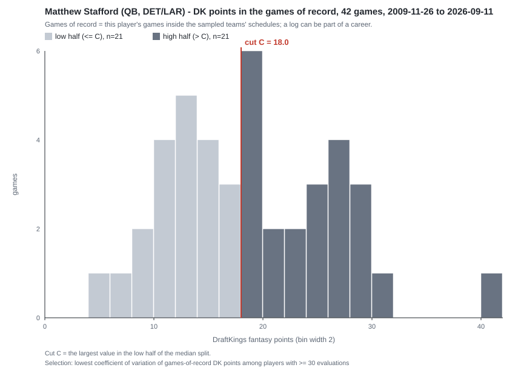
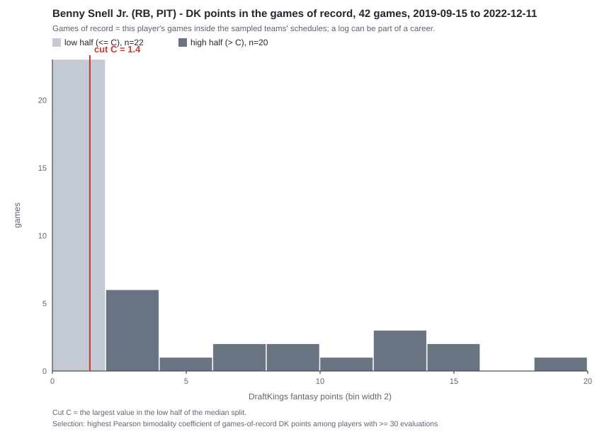
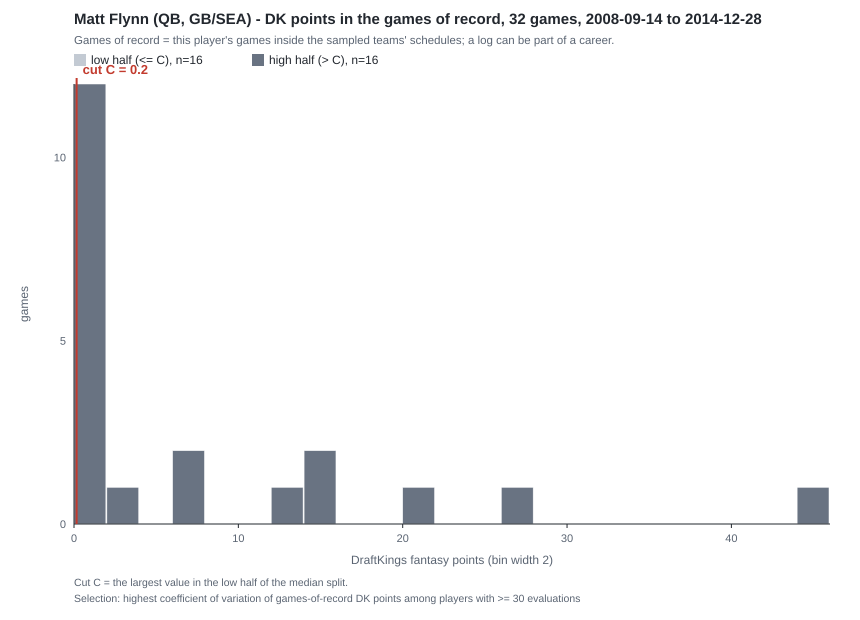
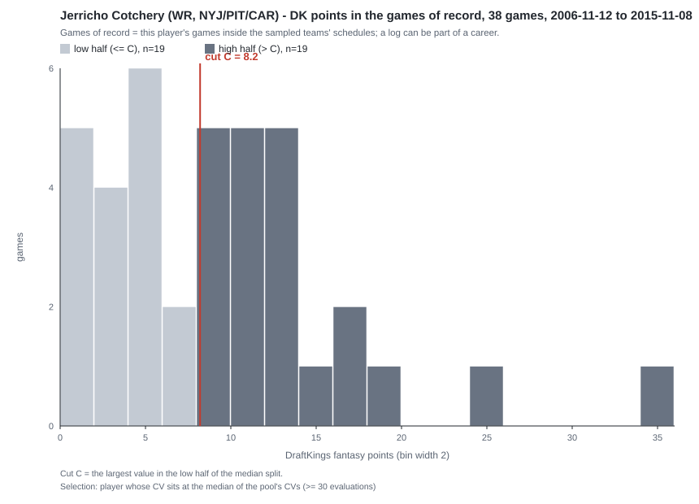
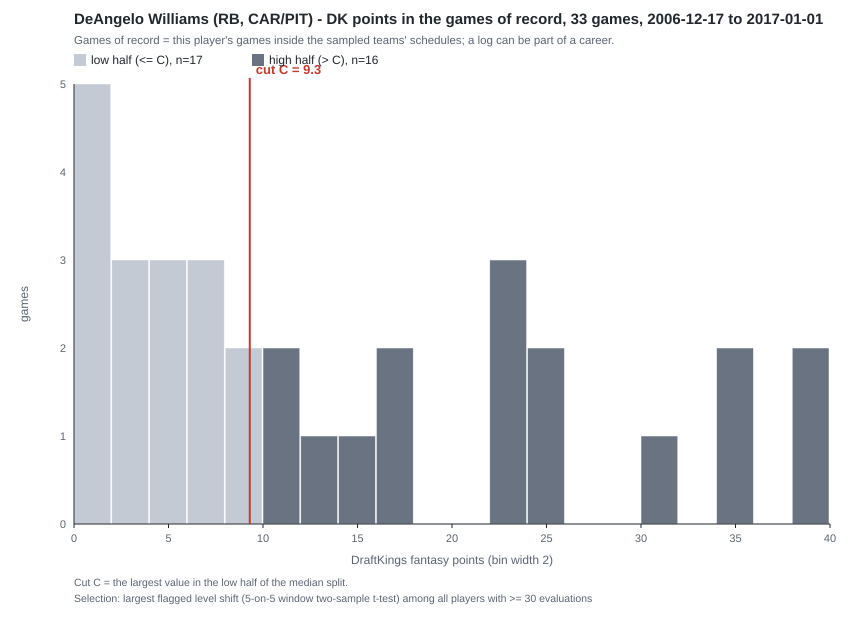
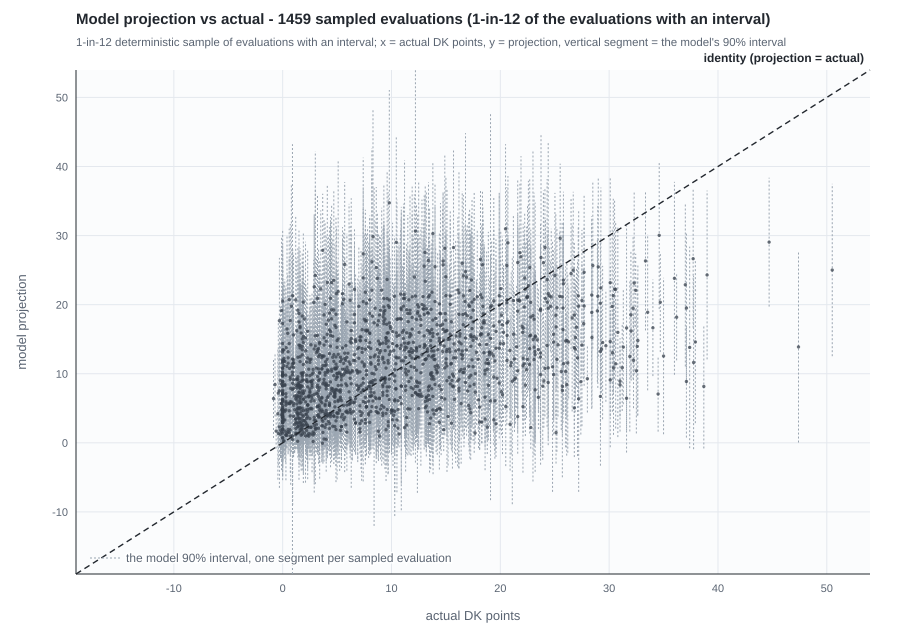
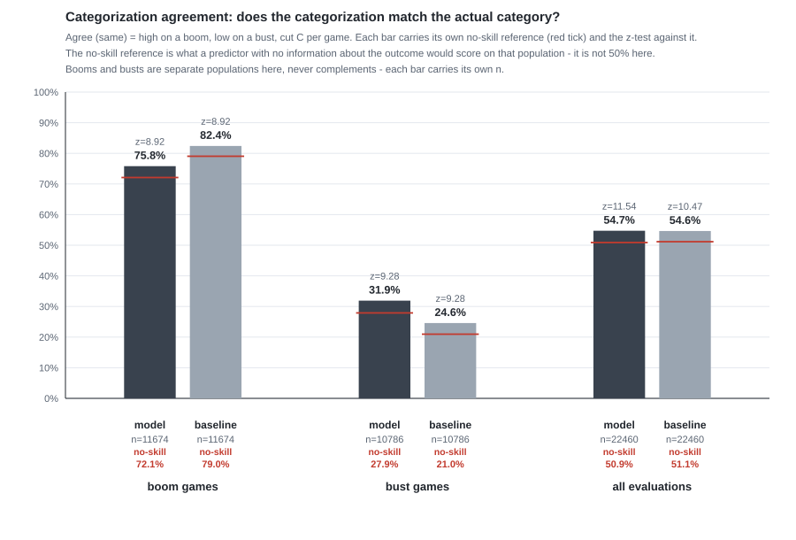
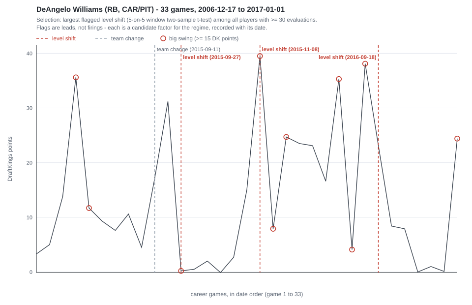

# Projection evaluation: the model against a plain baseline (mavis, 2026-11-08)

Built by mavis. Walk-forward evaluation of Dave's projection model — the engine is `frontend/react/src/lib/dave-projection.ts`, implemented exactly as his document (`docs/DFS Projection Model.md`) specifies — against a plain prior-games baseline, on **every** game of record ESPN publishes for the sampled teams (ne, gb, pit, sf; completed regular seasons 2002-2026), scored with DraftKings' published rubric.

This document supersedes `docs/mavis-accuracy-history.md` (deleted) and was rebuilt to the owner's spec: standard test names only; **no data omitted**; boom/bust defined once; multiple justified factors; visuals required; every count says exactly what it counts.

## The headline numbers

Agreement means the categorization matched the actual category — [high on a boom](#boom-game-and-bust-game), [low on a bust](#boom-game-and-bust-game), against the same [cut C](#cut-c) on both sides ([agreement](#agreement), defined once). Every rate carries its one-sample z-test against 50%.

| scope | model | baseline (plain prior-games average) |
|---|---|---|
| [Boom games](#boom-game-and-bust-game) (actual > C), categorized [high](#model-categorization) | **75.8%** (n=11,674, z=55.77) | 82.4% (n=11,674, z=70.03) |
| Bust games (actual ≤ C), categorized low | **31.9%** (n=10,786, z=-37.59) | 24.6% (n=10,786, z=-52.78) |
| [Overall](#agreement), all 22,460 [evaluations](#earlier-games-and-earlier_n) | **54.7%** (n=22,460, z=14.16) | 54.6% (n=22,460, z=13.91) |
| [Contained](#containment) in the model's 90% interval (supporting) | 71.0% (n=17,498) | n/a (the baseline carries no interval) |

**How to read this.** 50% is the spec's fixed reference and the z-tests are against it. It is not the whole story, because both sides categorize most games high ([model](#model-categorization): 16,195 of 22,460 = 72.1%; [baseline](#baseline): 17,754 of 22,460 = 79.0%) and 52.0% of the evaluations are booms (11,674 of 22,460). Under a no-skill null — categorization independent of outcome — those two rates alone would produce overall agreement of 50.9% for the model and 51.2% for the baseline. The observed 54.7% and 54.6% sit **+3.8 and +3.4 points above their own no-skill expectation**; that gap, not the z against 50%, is the honest size of each side's edge. Against each other: the baseline wins boom agreement (it leans high harder), the model wins bust agreement (it leans high less), overall is a tie to one decimal. Booms and busts are separate populations here, each with its own n — never complements.

## What was evaluated (the counts)

- **24,981 games of record** — every completed player-game in the dataset, written to the CSV. Nothing omitted.
- **22,460 evaluations** — games with at least one earlier game; every one carries a projection.
- **2,521 first games of record** — a player's first game in the dataset: no earlier games, so no cut and no projection; recorded as information ([defined below](#first-game-of-record)), not silence.
- **17,117 evaluations carry the [low-sample asterisk](#low-sample-asterisk)** (fewer than 30 earlier games) — still projected, still recorded.
- **5,343 evaluations at 30 or more earlier games** — the Central Limit Theorem threshold the owner set.
- **1,961 players evaluated** (at least one evaluation); **2,521 players seen** (at least one game of record).
- Data: 1,532 event summaries held (all planned; cached from the proven fetch layer and reused this run). This run made 2,061 HTTP requests (100 schedules + 1,961 exact-position lookups), 0 failures, 16 seconds.

Positions, both counts labeled (the old document's "QB 1,064" was evaluations, not players): QB = 3,364 evaluations by 250 players; RB = 6,597 by 559; WR = 7,868 by 697; TE = 3,662 by 336; FB = 920 by 85; refined ESPN lookups put small counts on P (33 by 17), PK (3 by 3), CB (6 by 3), OT (4 by 3), S (1 by 1), LB (2 by 1).

## Definitions

Every term is defined once, here, and used the same way everywhere.

### game of record
One completed game for one player in the dataset: an ESPN box-score line, scored with DraftKings' published rubric (passing/rushing/receiving yards and touchdowns, receptions, fumbles lost, the 100-yard and 300-yard bonuses). Every game of record is written to the CSV.

### first game of record
A player's first game in the dataset. It has no earlier games, so no cut and no projection exist for it. The CSV row says `first game of record (n=0)`. This is information, not silence — only this one class of game has no projection.

### earlier games and earlier_n
For a target game: that player's completed games whose date is **strictly before** the target game's date, all seasons in the dataset, sorted by date. `earlier_n` is their count. An **evaluation** is a target game with earlier_n ≥ 1.

### cut (C)
Split the earlier games' DK points in half at the median: sorted ascending, the LOW half takes the first ceil(n/2) games (an odd count puts the middle game in the LOW half). **C = the largest value in the LOW half.** Defined once and applied identically to the model's projection, the baseline's projection, and the actual outcome.

### boom game and bust game
Defined once, on the ACTUAL outcome, against C: a target game is a **boom** iff its actual DK points > C; a **bust** iff actual ≤ C. Because C is built from the player's own earlier games, booms are 52.0% of evaluations and busts 48.0% by construction — reported as separate populations with their own counts, never as complements.

### model categorization
The model categorizes a game **high iff its projection > C, low otherwise**. Same/different only: there are no misses, no side calls, no declines. The categorization is not the model's P — it is the comparison of the projection with the cut, the same comparison the baseline gets.

### baseline
The plain prior-games average: the arithmetic mean of all earlier games — no split, no factor, no weighting, no outlier removal. It is categorized against the **same C by the same rule**: high iff its average > C. Because an average of a boom/bust distribution sits above its median, the baseline categorizes high on 79.0% of evaluations; that is a property of the naive estimator, reported as it comes out.

### agreement
A categorization **agrees (same)** when it matches the actual category — high on a boom, low on a bust; otherwise **different**. Agreement rates are reported for the model and the baseline on booms, on busts, and overall, each with its one-sample z-test against 50% (z = (rate − 0.5) / sqrt(0.25/n)).

### P
P is the weight of the high half in the projection: **the empirical frequency of the winning factor's high-side condition for that player** — the share of the engine's post-peel earlier games where the condition holds (games with an unknown factor value are excluded from both numerator and denominator). The projection is his document's formula: high mean × P + low mean × (1 − P).

### model paths
Which rule produced the projection, recorded per evaluation:

- **F — factor:** a factor cleared the evidence floor (two-sample t-test, |t| ≥ 2); P = its empirical frequency; the formula is applied. 12,446 evaluations (55.4%).
- **R — raw average:** the two halves are the same population (Welch two-sample t, |t| < 2.1); the projection is the raw average of the earlier games — his document's definitional rule; P is not applied. 1,428 evaluations (6.4%).
- **E — even-split floor:** no factor cleared the evidence floor; P = 0.5 and the projection is the balanced average of the two half means — his document's definitional floor. 3,624 evaluations (16.1%).
- **P4 — plain average:** earlier_n < 4, too few games to split into halves; the only projection available is the plain average of the earlier games (identical to the baseline on those rows, which the path field makes transparent). 4,962 evaluations (22.1%).

### low-sample asterisk
Every game with earlier_n ≥ 1 gets a projection. Games with fewer than 30 earlier games are flagged in the `sample_flag` field ("low sample (n=12)") and are still projected and still counted. The 30-game line is the owner's Central Limit Theorem threshold; rows below it are asterisked, never dropped — recording them is the point (omitting low-confidence games is bias).

### containment
For evaluations with an interval (earlier_n ≥ 4): **same** when the actual DK points fall inside the model's 90% interval, **different** otherwise. Never called a miss. The interval is the engine's two-component mixture variance rebuilt at the evaluation's own P (within-half variances weighted by P and 1−P, plus the between-half term P(1−P)(highMean − lowMean)²), 1.6449 × sd on each side.

## Method, in order

1. **Data path** (the only public one that works today, carried over proven from the old harness): ESPN team schedule → event summary (box score for both teams) → DraftKings points per offensive player. Teams ne, gb, pit, sf; completed regular seasons 2002-2026; 1,532 games.
2. **Per-game factors** (all objective, all known before kickoff): `isHome` (boolean), `month` (categorical), `opponent` (categorical — the other team in the game), `restDays` (numeric — days since that player's previous game of record), `regimeShifts` (numeric — the number of [level-shift breakpoints](#breakpoints-leads-not-firings) recorded for the player strictly before that game).
3. **Walk forward** through each player's games. At each evaluation the model sees ONLY the earlier games: the engine splits them at the median, peels at most two multimodal outliers per half (skew/kurtosis test), computes the half means, ranks every candidate factor by its two-sample t-test (Welch, with/without the condition), and applies the sameness test between the halves.
4. **The winning factor** is the strongest by |t|; its high-side condition is the state whose games average higher. P = the condition's empirical frequency in the player's earlier games; projection = high mean × P + low mean × (1 − P). On the raw-average and even-split paths the projection follows his document's definitional rules instead (see [model paths](#model-paths)).
5. **Categorize and score:** model projection vs C, baseline average vs C, actual vs C — one cut, one rule. Agreement per side on booms, busts, overall; one-sample z vs 50% on each of the six rates.
6. The engine runs as its bare-Node mirror `scripts/dave-port.mjs`, parity-tested against the TypeScript engine by `scripts/dave-port.test.mjs` (identical projections, intervals, factors, breakpoints).

## The charts

matplotlib is not installed and the spec says install nothing, so the charts are hand-rendered SVG artifacts (script: `scripts/mavis-evaluation-charts.mjs`; data: the harness JSON). Colour rule: neutrals for structure, colour only where it means something — the cut line and level shifts are red (the statistical convention for the outlier boundary); everything else is gray.

### (a) Per-player games-of-record histograms, with the cut and the halves shaded

Five players, each selection rule recorded (the pool is players with ≥ 30 evaluations):

*Matthew Stafford (QB, DET/LAR) — 42 games of record, 2009-11-26 to 2026-09-11, C = 18.0. Selection: lowest coefficient of variation of games-of-record DK points.*

*Benny Snell Jr. (RB, PIT) — 42 games, 2019-09-15 to 2022-12-11, C = 1.4. Selection: highest Pearson bimodality coefficient — the boom/bust shape his model is built for.*

*Matt Flynn (QB, GB/SEA) — 32 games, 2008-09-14 to 2014-12-28, C = 0.16. Selection: highest coefficient of variation — mostly backup nights at near zero with a few spikes.*

*Jerricho Cotchery (WR, NYJ/PIT/CAR) — 38 games, 2006-11-12 to 2015-11-08, C = 8.2. Selection: CV at the median of the pool's CVs — the middle of the distribution of profiles.*

*DeAngelo Williams (RB, CAR/PIT) — 33 games, 2006-12-17 to 2017-01-01, C = 9.3. Selection: the largest flagged level shift in the dataset.*

### (b) Projection vs actual, identity line, interval band

*1,459 sampled evaluations (a deterministic 1-in-12 of the 17,498 with an interval; the method is stated on the chart). The dashed gray vertical segments are the model's 90% intervals, the dots are the projections, the solid diagonal is the identity line. The mass above the identity line at low actuals and below it at high actuals is the regression-to-the-mean any prior-games model shows; the interval segments are wide enough to cover most of it (71.0% same).*

### (c) Categorization agreement, model vs baseline, with the 50% line

*The six rates from the headline table, each bar carrying its own n and z. The red dashed line is 50%.*

### (d) One regime-shift player's timeline, breakpoints marked

*DeAngelo Williams (RB, CAR/PIT) — 33 games of record, 14 breakpoint flags. The flagged level shifts bracket his 2015 Pittsburgh stretch: 5-game mean 14.22 → 1.06 (flagged 2015-09-27, t=-2.76), then 4.02 → 23.74 (flagged 2015-11-08, t=3.44) when he filled in for Le'Veon Bell, then 23.44 → 8.10 (flagged 2016-09-18). Each flag carries the two-sample t-test between its 5-on-5 windows.*

## A sample of the per-game CSV (40 rows)

The full CSV is `frontend/react/.tmp-audit/projection-evaluation.csv` (git-ignored): all 24,981 games of record — 22,460 evaluations + 2,521 first games — one row per game, every categorization carrying its justification. Shown here: Tom Brady's first 40 evaluations (the most-evaluated player), with the path codes from [model paths](#model-paths).

PATH CODES: F = factor (evidence floor cleared, P = empirical frequency, formula applied) | R = raw average (halves one population, his definitional rule) | E = even-split floor (no factor cleared the floor, P = 0.5) | P4 = plain average (n<4, too few games to split)

| date | earlier_n | sample flag | cut C | actual | actual category | path | winning factor | P | high mean | low mean | projection | 90% interval | containment | model category | model agreement | baseline projection | baseline agreement |
|---|---|---|---|---|---|---|---|---|---|---|---|---|---|---|---|---|---|
| 2002-09-15 | 1 | low sample (n=1) | 23.76 | 18.26 | bust | P4 |  |  |  |  | 23.76 |  |  | low | same | 23.76 | same |
| 2002-09-22 | 2 | low sample (n=2) | 18.26 | 34.6 | boom | P4 |  |  |  |  | 21.01 |  |  | high | same | 21.01 | same |
| 2002-09-29 | 3 | low sample (n=3) | 23.76 | 23.42 | bust | P4 |  |  |  |  | 25.54 |  |  | high | different | 25.54 | different |
| 2002-10-06 | 4 | low sample (n=4) | 23.42 | 14.6 | bust | R |  |  | 29.18 | 20.84 | 25.01 | 15.22..34.8 | different | high | different | 25.01 | different |
| 2002-10-13 | 5 | low sample (n=5) | 23.42 | 9.92 | bust | R |  |  | 29.18 | 18.76 | 22.93 | 11.68..34.17 | different | low | same | 22.93 | same |
| 2002-10-27 | 6 | low sample (n=6) | 18.26 | 9.7 | bust | F | month | 0.6667 | 27.26 | 14.26 | 22.93 | 10.46..35.4 | different | high | different | 20.76 | different |
| 2002-11-03 | 7 | low sample (n=7) | 18.26 | 22.5 | boom | F | month | 0.5714 | 27.26 | 13.12 | 21.2 | 7.91..34.49 | same | high | same | 19.18 | same |
| 2002-11-10 | 8 | low sample (n=8) | 18.26 | 27.72 | boom | F | month | 0.5714 | 23.23 | 13.12 | 18.9 | 10.15..27.64 | different | high | same | 19.6 | same |
| 2002-11-18 | 9 | low sample (n=9) | 22.5 | 5.98 | bust | F | month | 0.6667 | 27.38 | 15 | 23.25 | 11.69..34.81 | different | high | different | 20.5 | same |
| 2002-11-24 | 10 | low sample (n=10) | 18.26 | 21.96 | boom | F | month | 0.6667 | 24.35 | 11.69 | 20.13 | 9.66..30.6 | same | high | same | 19.05 | same |
| 2002-11-28 | 11 | low sample (n=11) | 21.96 | 8.6 | bust | F | month | 0.7 | 24.35 | 13.4 | 21.07 | 11.91..30.22 | different | low | same | 19.31 | same |
| 2002-12-08 | 12 | low sample (n=12) | 18.26 | 14.82 | bust | F | month | 0.3 | 22.91 | 11.18 | 14.7 | 4.46..24.93 | same | low | same | 18.42 | different |
| 2002-12-17 | 13 | low sample (n=13) | 18.26 | 11.36 | bust | F | month | 0.2727 | 22.91 | 11.7 | 14.76 | 5.06..24.45 | same | low | same | 18.14 | same |
| 2002-12-23 | 14 | low sample (n=14) | 14.82 | 10.72 | bust | F | month | 0.7857 | 24.6 | 10.71 | 21.63 | 10.02..33.23 | same | high | different | 17.66 | different |
| 2002-12-29 | 15 | low sample (n=15) | 14.82 | 11.64 | bust | F | month | 0.2667 | 24.6 | 10.71 | 14.42 | 3.46..25.37 | same | low | same | 17.19 | different |
| 2003-09-07 | 16 | low sample (n=16) | 14.6 | 0.92 | bust | F | month | 0.25 | 23.38 | 10.32 | 13.58 | 3.48..23.68 | different | low | same | 16.85 | different |
| 2003-09-14 | 17 | low sample (n=17) | 14.6 | 22.9 | boom | E |  | 0.5 | 23.38 | 9.27 | 16.33 | 3.33..29.32 | same | high | same | 15.91 | same |
| 2003-09-21 | 18 | low sample (n=18) | 14.6 | 12.14 | bust | F | month | 0.8333 | 23.33 | 9.27 | 20.98 | 9.43..32.54 | same | high | different | 16.3 | different |
| 2003-09-28 | 19 | low sample (n=19) | 14.6 | 16.76 | boom | F | month | 0.7778 | 23.33 | 10.52 | 20.48 | 9.16..31.8 | same | high | same | 16.08 | same |
| 2003-10-05 | 20 | low sample (n=20) | 14.6 | 12.96 | bust | F | month | 0.7895 | 22.67 | 10.52 | 20.11 | 9.12..31.1 | same | high | different | 16.11 | different |
| 2003-10-12 | 21 | low sample (n=21) | 14.6 | 4.48 | bust | F | month | 0.8 | 22.67 | 10.76 | 20.29 | 9.47..31.11 | different | high | different | 15.96 | different |
| 2003-10-19 | 22 | low sample (n=22) | 12.96 | 19.32 | boom | F | month | 0.7619 | 21.94 | 9.75 | 19.03 | 7.71..30.36 | same | high | same | 15.44 | same |
| 2003-10-26 | 23 | low sample (n=23) | 14.6 | 10.16 | bust | E |  | 0.5 | 22.37 | 9.42 | 15.89 | 3.91..27.88 | same | high | different | 15.61 | different |
| 2003-11-04 | 24 | low sample (n=24) | 12.96 | 26.9 | boom | F | month | 0.3043 | 21.72 | 9.79 | 13.42 | 3.5..23.33 | different | high | same | 15.38 | same |
| 2003-11-17 | 25 | low sample (n=25) | 14.6 | 8.78 | bust | F | month | 0.72 | 22.74 | 9.48 | 19.03 | 7.23..30.83 | same | high | different | 15.84 | different |
| 2003-11-23 | 26 | low sample (n=26) | 12.96 | 24.22 | boom | F | month | 0.72 | 22.12 | 9.7 | 18.64 | 7.27..30.01 | same | high | same | 15.57 | same |
| 2003-11-30 | 27 | low sample (n=27) | 14.6 | 15.34 | boom | F | month | 0.7407 | 22.86 | 9.43 | 19.37 | 7.74..31.01 | same | high | same | 15.89 | same |
| 2003-12-07 | 28 | low sample (n=28) | 14.6 | 6.32 | bust | F | month | 0.75 | 22.32 | 9.43 | 19.1 | 7.7..30.49 | different | high | different | 15.87 | different |
| 2003-12-14 | 29 | low sample (n=29) | 14.6 | 17.82 | boom | F | month | 0.8276 | 22.32 | 9.22 | 20.06 | 9.11..31.01 | same | high | same | 15.54 | same |
| 2003-12-21 | 30 |  | 14.6 | 13.62 | bust | F | opponent | 0.9333 | 22.02 | 9.22 | 21.17 | 11.51..30.82 | same | high | different | 15.62 | different |
| 2003-12-27 | 31 |  | 14.6 | 25.46 | boom | F | opponent | 0.9355 | 22.02 | 9.49 | 21.21 | 11.65..30.78 | same | high | same | 15.55 | same |
| 2004-09-10 | 32 |  | 14.6 | 27.3 | boom | F | opponent | 0.9375 | 22.24 | 9.49 | 21.44 | 11.99..30.89 | same | high | same | 15.86 | same |
| 2004-09-19 | 33 |  | 14.82 | 14.06 | bust | F | opponent | 0.9394 | 23.02 | 9.81 | 22.21 | 13.03..31.4 | same | high | different | 16.21 | different |
| 2004-10-03 | 34 |  | 14.6 | 20.12 | boom | F | opponent | 0.9412 | 22.53 | 9.76 | 21.78 | 12.4..31.16 | same | high | same | 16.15 | same |
| 2004-10-10 | 35 |  | 14.82 | 9.94 | bust | F | opponent | 0.9429 | 22.84 | 10.04 | 22.11 | 13.2..31.02 | different | high | different | 16.26 | different |
| 2004-10-17 | 36 |  | 14.6 | 11.94 | bust | F | opponent | 0.9444 | 22.4 | 9.77 | 21.7 | 12.55..30.85 | different | high | different | 16.09 | different |
| 2004-10-24 | 37 |  | 14.6 | 12.9 | bust | F | opponent | 0.9459 | 22.4 | 9.89 | 21.72 | 12.62..30.83 | same | high | different | 15.97 | different |
| 2004-10-31 | 38 |  | 14.06 | 15.84 | boom | F | opponent | 0.9459 | 21.99 | 10.29 | 21.36 | 12.16..30.55 | same | high | same | 15.89 | same |
| 2004-11-07 | 39 |  | 14.6 | 16.46 | boom | F | opponent | 0.9474 | 22.05 | 10.52 | 21.45 | 12.42..30.47 | same | high | same | 15.89 | same |
| 2004-11-15 | 40 |  | 14.6 | 16.52 | boom | F | opponent | 0.9487 | 21.77 | 10.52 | 21.2 | 12.21..30.19 | same | high | same | 15.91 | same |

Every row's `justification` cell is a complete sentence. One verbatim example (the 2003-12-21 row above):

> factor opponent: opponent!=TEN (two-sample t-test t=2.15, df=14.49; scores average 15.87 in n=28 games when the condition holds vs 12.16 in n=2 games when it does not); P=0.9333 (the empirical frequency of the winning condition among the earlier games); half means high 22.02 / low 9.22; cut C=14.6 from 30 earlier games; projection 21.17 vs C -> categorized high; actual 13.62 vs C -> bust; categorization different

Note what the example shows honestly: the winning condition is rare (n=2 of 30), so its empirical frequency is 0.9333 and the projection sits near the high mean — the [P rule](#p) makes rare conditions weight the high half hard. That behaviour is visible across the run (mean P = 0.5515 over the 16,070 evaluations where the formula applied) and it is the owner's rule applied as specified.

## By era

| era | evaluations | boom games | bust games | model boom | baseline boom | model bust | baseline bust | model overall | baseline overall | model containment |
|---|---|---|---|---|---|---|---|---|---|---|
| 2002-2008 | 3,113 | 1,651 | 1,462 | 74.8% | 77.8% | 36.2% | 32.7% | 56.7% | 56.6% | 71.2% (n=2,175) |
| 2009-2014 | 6,165 | 3,151 | 3,014 | 76.0% | 83.4% | 31.5% | 23.7% | 54.2% | 54.2% | 70.3% (n=4,708) |
| 2015-2020 | 6,674 | 3,535 | 3,139 | 76.0% | 83.1% | 31.9% | 22.9% | 55.2% | 54.8% | 71.7% (n=5,264) |
| 2021-2026 | 6,508 | 3,337 | 3,171 | 76.0% | 83.1% | 30.4% | 23.4% | 53.8% | 54.0% | 70.8% (n=5,351) |

The per-season table (25 seasons, same columns) is in the JSON (`coverage.perSeason`). The shape is stable everywhere: the baseline's boom edge and the model's bust edge hold in all four eras; overall agreement stays within 3 points of a tie.

## Which factors win, and where P lands

Across the 12,446 factor-path evaluations: opponent 6,263 (50.3%), month 2,678 (21.5%), regimeShifts 1,246 (10.0%), restDays 964 (7.7%), isHome 677 (5.4%), team 618 (5.0%). The engine's ranked-factor machinery makes the pool extensible — a new pre-game field is one more candidate key.

Mean P = 0.5515 where the formula applied. The frequency rule keeps P near its base rates: common conditions land near 0.5 (the even-split floor does the work), rare conditions land near 0 or 1. The model categorized high on 72.1% of evaluations — less high-leaning than the baseline's 79.0%, which is where its bust advantage comes from.

## Breakpoints: leads, not firings

`detectBreakpoints` walks each player's career chronologically and flags, with dates: **team changes**, **big swings** (≥ 15 DK points in one game), and **level shifts** (5-on-5 window means differing by ≥ 6 DK points with the two-sample t clearing |t| ≥ 2, cooldown 5). Nothing is deleted or reweighted on a flag — flags are recorded into the player's record and charted (chart d), and the feedable form enters the factor pool as `regimeShifts`, which won 10.0% of factor-path evaluations. Projections run within the right regime once the regime is established by the factor machinery, not by hand.

## Not feedable today (listed, never faked)

- **Receiver availability / injuries** — the pipeline's only sources are ESPN schedules and box scores; there is no pre-game injury or active-roster feed. A projection that knew a receiver was out would be using information this pipeline does not have.
- **Snap counts, targets, usage share** — in-game data, known only after kickoff.
- **Weather** — not exposed by the ESPN summary payload this harness consumes.
- **Betting lines / implied totals** — market data, not the player's objective game record, and no feed in this pipeline; his rule is objective data only.
- **Coaching / play-caller changes** — not in the box score.

Each would enter as one more candidate factor key the day a feed exists. None is estimated, implied or guessed here.

## Caveats, stated plainly

- **A log is a games-of-record set, not always a career.** Event summaries are pulled from the sampled teams' schedules, so a player's log holds the games of theirs inside those schedules: essentially a full career for the four sampled teams' own players, only the matchups for everyone else. `earlier_n` counts games of record and can understate a true career count — conservative in the same direction as the old 30-game gate.
- **The 90% interval is anticonservative.** Containment is 71.0%, not 90%: with halves this small the normal quantile understates the tails. Treat containment as a relative line only.
- **Two-point conversions** are absent from ESPN's receiving box group (carried over from the old run), worth a fraction of a point per game.
- **Positions** are inferred from the box score, then refined by exact ESPN athlete lookups for all 1,961 evaluated players (0 failures); the small refined counts (P, PK, CB, OT, S, LB) are reported as-is.
- **No contest-level metrics.** DraftKings contest results are not public; winning-contests-predicted and ROI stay pending a feed, as in the old document. Not faked.
- **The z-tests are against the spec's fixed 50%**, which on this constructed split is not a skill line by itself — the no-skill expectations in [how to read this](#the-headline-numbers) are the honest comparison.

## Verdict, without spin

On 22,460 evaluations over 1,961 players: the **baseline wins boom agreement** (82.4% vs 75.8%), the **model wins bust agreement** (31.9% vs 24.6%), and **overall is a tie** (54.7% vs 54.6%). Both sides clear their own no-skill expectation by a similar margin (+3.8 model, +3.4 baseline) — the factor machinery, on this data, moves the shape of the agreement (boom edge traded for bust edge) more than its size. The model's edge is real but small, and the honest summary is: one cut, one rule, standard tests, every game recorded — the model buys bust sensitivity at the cost of boom agreement, and does not yet beat the plain average overall.

## Files, and how to rebuild

- Harness: `frontend/react/scripts/mavis-projection-evaluation.mjs` (replaces `scripts/mavis-accuracy-history.mjs`, deleted; the ESPN fetch layer was carried over verbatim).
- Chart script: `frontend/react/scripts/mavis-evaluation-charts.mjs`.
- Engine: `frontend/react/src/lib/dave-projection.ts`; bare-Node mirror `frontend/react/scripts/dave-port.mjs`; parity + hand-computed cases in `scripts/dave-port.test.mjs` and `src/lib/dave-projection.test.ts`.
- Per-game CSV (git-ignored): `frontend/react/.tmp-audit/projection-evaluation.csv` — 24,981 rows.
- Summary JSON: `frontend/react/.tmp-audit/projection-evaluation.json` — headline rates, per-era and per-season tables, factor usage, chart data, selection reasons.
- Charts: `docs/shots/mavis-eval-*.svg` (8 files).

Rebuild from `frontend/react`: `node scripts/mavis-projection-evaluation.mjs` then `node scripts/mavis-evaluation-charts.mjs`. The 1,532 event summaries are cached in the OS temp directory (`mavis-accuracy-cache/events.json`); `MAVIS_REFRESH=1` refetches everything. Teams/seasons: `MAVIS_TEAMS`, `MAVIS_SEASON_START`, `MAVIS_SEASON_END`.

QA note for this change: `docs/QA-2026-11-05-to-07.md`, section 7.
